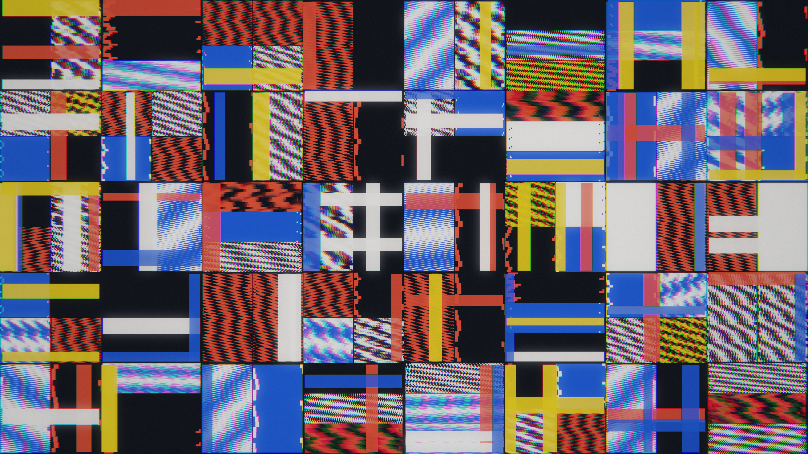

# bitplane_moire_polyptych

## Metadata
- **Date**: 2026-11-14
- **Genre**: Signal / Glitch / Digital Artifacts
- **Composition Archetype**: Full-Canvas Polyptych / Rhythmic Matrix
- **Motion Archetype**: Multi-Act Temporal Evolution
- **Tonal Family**: Stark Constructivist High-Contrast
- **Theme**: An edge-to-edge constructivist transmission matrix fracturing through quantized bitplane XOR shear and high-frequency moiré interference before re-locking into stark geometric poise
- **Technique**: Hierarchical polyptych subdivision + 6-bit quantized XOR carpet & dual-grating moiré shader (`bitplane_moire_polyptych.glsl`) + stepped constructivist shutter blocks (`py5.QUADS`) + `PostFX` chromatic aberration
- **Logic Lab Reference**: None

## Concept
Across 100% of the 3840×2160 frame, an asymmetric 8×5 polyptych matrix with nested sub-registers partitions the canvas into pure visual signal cells. Over a 17-second (1020-frame) four-act cycle, the cells progress from harmonic carrier lock through horizontal scanline phase slippage and counter-rotating moiré superlattices to a quiet constructivist resolution in carbon black (`#111317`), bone white (`#f2efe9`), signal vermilion (`#e63426`), international ultramarine (`#183ad4`), and cadmium ochre (`#f2b418`).

## Technical Details
- **Renderer**: `P2D` (OpenGL)
- **Simulation**: Per-pixel 6-bit integer XOR interferometry + dual-grating wave multiplication in GLSL + 96 quantized constructivist shutter bars in NumPy
- **Visuals**: Full-bleed polyptych matrix (`load_shader` + `draw_fullscreen`), crisp geometric shutter quads (`py5.QUADS`), and `PostFX` (`aberration=0.0024`, `bloom=0.22`, `grain=0.022`)
- **Animation**: 17s (1020 frames @ 60fps)

