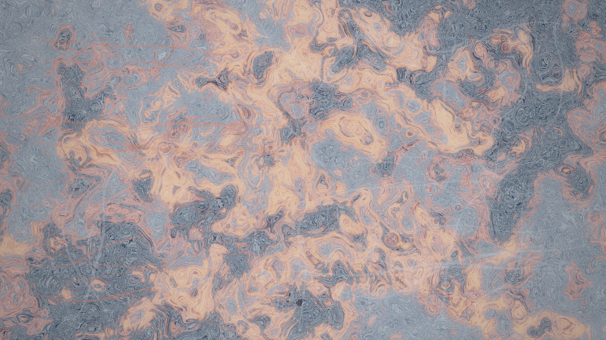

# cinnabar_ink_fronts

## Metadata
- **Date**: 2026-11-14
- **Genre**: Atmospheric / Painterly / Color Field
- **Composition Archetype**: Emergent Network / Boundary-to-Interior Growth
- **Motion Archetype**: Directional Advection & Traveling Wavefronts
- **Tonal Family**: Deep Nocturnal Monochrome + Single Accent
- **Theme**: Colliding wet sumi-e ink tides advancing from opposite boundaries of dark slate paper, igniting molten cinnabar seams where opposing capillary fronts meet
- **Technique**: GPU fragment-shader curl-warped multi-front advection (`cinnabar_ink_fronts.glsl`) + tapered capillary wash ribbons (`py5.QUADS`) + `PostFX` filmic tone-mapping and bloom
- **Logic Lab Reference**: None

## Concept
Across the full-bleed 3840×2160 frame, four asymmetric ink-wash fronts nucleate from the perimeter margins and push inward through multi-scale curl-noise advection. As the pewter and silver-mist pigment clouds converge in open space, their opposing wavefronts compress into luminous fault lines and branching capillary veins tinted in a single restrained accent of molten cinnabar (`#e85234`).

## Technical Details
- **Renderer**: `P2D` (OpenGL)
- **Simulation**: 2D curl-noise domain-warped boundary front advection in GLSL + vectorized NumPy capillary ribbon geometry (`56` tapered ribbons × `48` nodes)
- **Visuals**: Full-bleed GPU color-field shader (`load_shader` + `draw_fullscreen`), translucent sumi/cinnabar ribbon strips (`py5.QUADS`), and `PostFX` (`bloom=0.45`, `tonemap=0.95`, `vignette=0.18`, `grain=0.025`)
- **Animation**: 15s (900 frames @ 60fps)

