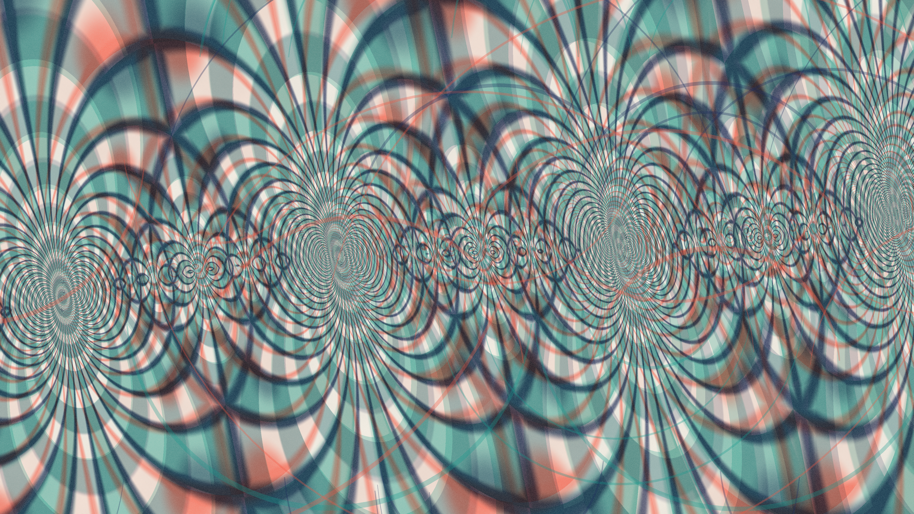

# hyperbolic_risograph_geodesics

## Metadata
- **Date**: 2026-11-14
- **Genre**: Mathematical / Abstract Topology
- **Composition Archetype**: Full-Bleed Continuous Field
- **Motion Archetype**: Spatial Camera / Depth Traversal
- **Tonal Family**: Risograph Overprint Spot Inks
- **Theme**: Gliding continuously through a non-Euclidean modular tessellation of hyperbolic arches printed in misregistered teal, fluorescent coral, and indigo risograph spot inks on warm cotton paper
- **Technique**: Iterative $\text{PSL}(2, \mathbb{Z})$ Möbius domain folding in GLSL (`hyperbolic_risograph_geodesics.glsl`) + vectorized Poincaré semicircular geodesic ribbon arches (`py5.QUADS`)
- **Logic Lab Reference**: None

## Concept
Across the entire 3840×2160 warm cotton paper canvas (`#ede8de`), a continuous loxodromic camera traversal glides through nested Poincaré upper-half-plane geodesics and modular $\text{PSL}(2, \mathbb{Z})$ fundamental domains. Three slightly offset spot-ink plates — translucent teal (`#169a8e`), fluorescent coral (`#f05a46`), and deep overprint indigo (`#1e2d5c`) — multiply across textured paper fibers and halftone grain.

## Technical Details
- **Renderer**: `P2D` (OpenGL)
- **Simulation**: Iterative complex Möbius reflection $T(z) = z - \lfloor \text{Re}(z) + 1/2 \rfloor$, $S(z) = -1/z$ in GLSL + 36 animated Poincaré geodesic arch ribbons in NumPy
- **Visuals**: Subtractive risograph spot-ink multiplication with deliberate plate misregistration and paper fiber noise across 100% of the canvas
- **Animation**: 16s (960 frames @ 60fps)

