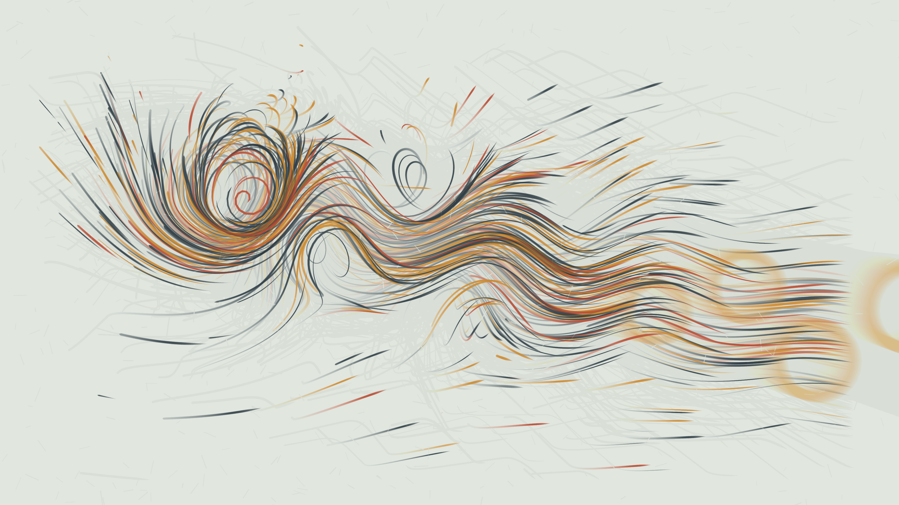

# karman_washi_vortices

## Metadata
- **Date**: 2026-11-14
- **Genre**: Physical / Micro-Kinetic
- **Composition Archetype**: Asymmetric Off-Center Tension
- **Motion Archetype**: Persistent Trail Accumulation & Decay
- **Tonal Family**: High-Key Mineral & Washi (Full-Canvas Light)
- **Theme**: Alternating hydrodynamic eddies peeling away from an off-center submerged stone and trailing iron-slate, mineral ochre, and burnt terracotta wash ribbons into expansive pale-sage washi negative space
- **Technique**: Vectorized Biot-Savart / Lamb-Oseen von Kármán vortex-street velocity field advecting 360 tapered quad ribbons (`py5.QUADS`) with translucent frame-fade persistence
- **Logic Lab Reference**: None

## Concept
Anchored near the upper-left golden-ratio focal zone of a pale celadon-sage washi canvas (`#e8ede6`), a submerged cylindrical shear obstacle sheds a staggered street of 14 counter-rotating Lamb-Oseen vortices. As 360 articulated brush ribbons advect through the Biot-Savart velocity field, they deposit layered calligraphic traces of iron-gall slate (`#26343c`), raw mineral ochre (`#c88428`), and burnt terracotta (`#b84830`) that gradually dissolve into generous, textured negative space toward the lower right.

## Technical Details
- **Renderer**: `P2D` (OpenGL)
- **Simulation**: Analytical potential-flow doublet + 14-vortex Lamb-Oseen Biot-Savart superposition in NumPy
- **Visuals**: Persistent translucent paper-wash accumulation (`fill(232, 237, 230, 9)`) + 360 tapered 22-node ribbon meshes batched via `py5.QUADS` / `py5.vertices`
- **Animation**: 18s (1080 frames @ 60fps)

