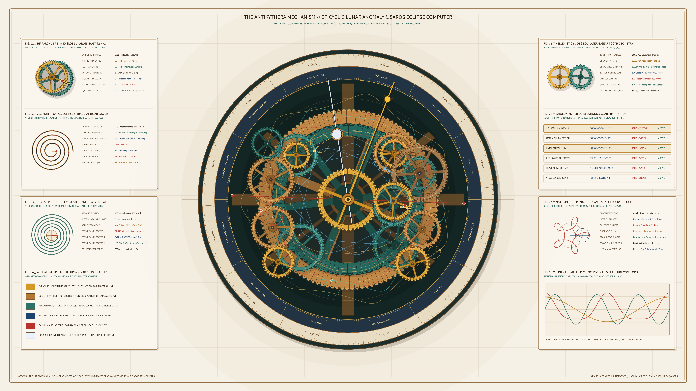

# Kinetic Antikythera Epicyclic Lunar & Saros Mechanism 2D



## Overview
- **Genre**: `7. Physical / Micro-Kinetic`
- **Format**: 4K 60fps Animation (`3840 × 2160`, 720 frames, 12.0s seamless harmonic loop)
- **Ground**: Warm Aegean Papyrus & Pentelic Marble Drafting Vellum (`#f6f1e6`)

## Concept & Historical Grounding
Discovered in 1901 in a Roman-era shipwreck off Point Glyphadia on the Greek island of Antikythera and decoded through micro-focus X-ray computed tomography (Derek J. de Solla Price 1974; Michael Wright 2005; Tony Freeth et al., *Nature* 2006 & *Scientific Reports* 2021), the **Antikythera Mechanism** (c. 150–100 BCE) is the oldest known geared astronomical computer and epicyclic planetarium.

This 4K 60fps kinetic study visualizes:
1. **Multi-Layered Hellenistic Bronze Gear Train**: Over 15 interlocking bronze gears with authentic $60^\circ$ equilateral triangular teeth—including the 224-tooth Main Solar Drive Wheel ($b_1$), the $254:19$ Babylonian Sidereal-Tropical Lunar Train ($b_2, c_1, c_2, d_1, d_2, e_2$), the 19-year Metonic and 76-year Callippic Train ($l_1, l_2, m_1, n_1$), and the 223-month Saros / 669-month Exeligmos Eclipse Train ($e_3, f_1, g_1, h_1$).
2. **Hipparchus's Epicyclic Pin-and-Slot Lunar Anomaly ($k_1 / k_2$)**: Mounted on the rotating epicyclic carrier turntable, two 50-tooth gears ($k_1, k_2$) with eccentric axes ($e \approx 1.12\text{ mm}$) engage via a radial slot and sliding pin, modulating the Moon pointer's angular velocity $\dot{\theta}_M(t)$ according to Hipparchus's eccentric lunar theory while precessing at the 8.85-year apsidal cycle.
3. **Concentric Zodiac & Egyptian Sothic Calendar Rings + Planetary Epicycles**: Graduated $360^\circ$ Hellenistic Zodiac (`KRIOS` through `ICHTHYES`) and 365-day Egyptian calendar (`THOTH` through `MESORE`) rings enclose five geocentric deferent-plus-epicycle planetary pointers tracing live retrograde station loops, a golden Helios solar ray pointer, a draconic eclipse node dragon hand, and a revolving 3D half-silvered / half-obsidian Lunar Phase Sphere ($b_0$).
4. **Eight Archaeometric & Astronomical Apparatuses**:
   - `FIG. 01` // Hipparchus Pin-and-Slot Lunar Anomaly ($k_1 / k_2$) Kinematic Close-Up
   - `FIG. 02` // 223-Month Saros Eclipse Spiral Dial & Glyph Predictor (`S = SELENES`, `H = HELIOU`)
   - `FIG. 03` // 19-Year Metonic Spiral (235 Synodic Months) & 4-Year Stephanitic Games Dial
   - `FIG. 04` // Archaeometric Cu-Sn Alloy & Marine Malachite Patina Stratigraphy
   - `FIG. 05` // Hellenistic $60^\circ$ Equilateral Triangular Gear Tooth Meshing Profile
   - `FIG. 06` // Babylonian Period Relations & Exact Prime-Factorized Gear Train Ratios
   - `FIG. 07` // Apollonius-Hipparchus Planetary Epicycle & Retrograde Station Loop ($S_1, S_2$)
   - `FIG. 08` // Lunar Anomalistic Velocity & Draconic Eclipse Latitude Waveform

## Run Instructions
```bash
uv run python sketch/kinetic_antikythera_epicyclic_lunar_saros_mechanism_2d/main.py
```

