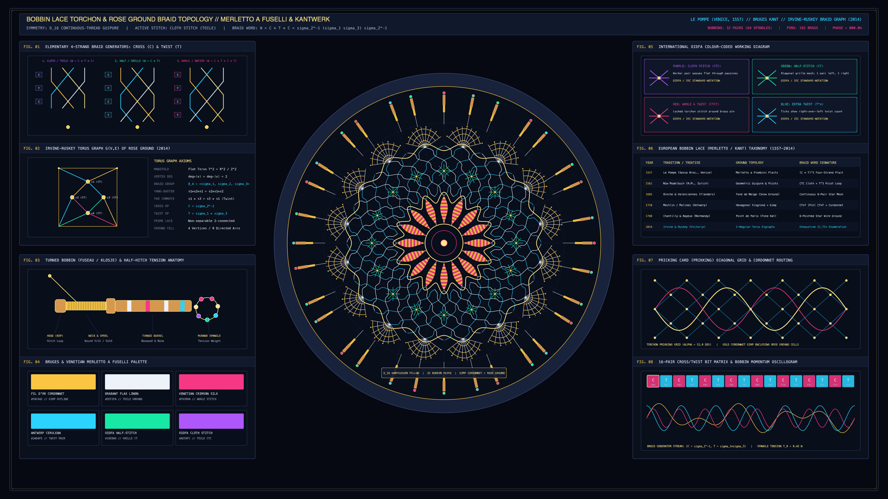

# kinetic_bobbin_lace_torchon_rose_ground_braid_topology_2d

> **"Merletto a Fuselli & Kantwerk: Bobbin Lace Torchon & Rose Ground Braid Topology"** — A 4K 60fps procedural textile and algebraic braid-group animation of Flemish and Venetian continuous-thread bobbin lace on a velvet *Kantkussen* pillow, governed by the 4-strand Artin braid generators $\text{Cross } (C = \sigma_2^{-1})$ and $\text{Twist } (T = \sigma_1 \sigma_3) \in B_4$.



## Concept & Mathematical Lace Topology

From the earliest printed Venetian bobbin-lace treatise (*Le Pompe*, 1557) and 17th-century Bruges, Binche, and Mechlin *Kantwerk* to **Veronika Irvine and Frank Ruskey's** mathematical formalization (*Journal of Mathematics and the Arts*, 2014), every continuous-thread bobbin lace ground is a physical realization of an embedded 2-regular directed graph on the flat torus $\mathbb{T}^2 = \mathbb{R}^2 / \mathbb{Z}^2$ whose 4-valent vertices are decorated by words in two elementary 4-strand Artin braid group ($B_4$) generators:

1. **Cross ($C = \sigma_2^{-1}$)**: Passing the inner left strand over the inner right strand.
2. **Twist ($T = \sigma_1 \sigma_3$)**: Simultaneously passing the right strand over the left strand within both the left pair $(1, 2)$ and right pair $(3, 4)$.

Combinations of $\{C, T\}^*$ around brass pins (*Épingles*) generate the classic lace stitches:
- **Cloth / Linen Stitch (*Toile / Mat*)**: $W = C \cdot T \cdot C$ (OIDFA Purple)
- **Half-Stitch / Grille (*Demi-Point*)**: $W = C \cdot T$ (OIDFA Green)
- **Whole-Stitch & Twist (*Point Entier*)**: $W = C \cdot T \cdot C \cdot T$ (OIDFA Red)
- **Rose / Virgin Ground (*Fond Vierge / Point de Rose*)**: $D_4$-symmetric 4-pin rosette cells enclosed by a heavy gold *Cordonnet* gimp outline.

## Technical Implementation

- **$D_{16}$ Polar Lace Medallion & 32 Swinging Bobbins (`NumPy` + `py5`)**: Renders 32 turned boxwood bobbins (*Fuselli / Klosjes*) with wound gold thread spools and Venetian Murano glass spangle beads (*Kralenringen*) swinging harmonically around 16 outer Torchon *Coquille* scallop fans, a counter-rotating 64-strand Rose-Ground mesh, 16 emerald 8-legged spiders, and 16 striped crimson-and-gold *Toile* guipure petals batched via `py5.QUADS` and `py5.lines`.
- **Eight Textile & Braid-Theory Telemetry Apparatuses (`FIG. 01`–`FIG. 08`)**: Includes the 4-strand `C/T` generator trees, Irvine-Ruskey $\mathbb{T}^2$ torus digraph, turned bobbin & spangle anatomy, OIDFA international color-coded working diagrams, 1557–2014 lace taxonomy, $52^\circ$ Torchon *Prikking* grid, and 16-pair `C/T` operator stream.

## Run

```bash
uv run python sketch/kinetic_bobbin_lace_torchon_rose_ground_braid_topology_2d/main.py
```

