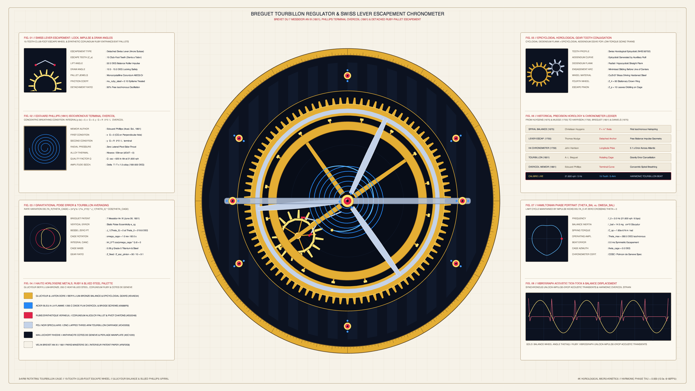

# kinetic_breguet_tourbillon_swiss_lever_escapement_chronometer_2d

> **"Le Tourbillon: Compensation des Anomalies de la Pesanteur"** — A 4K 60fps micro-kinetic horological treatise of Abraham-Louis Breguet's patented 1801 Tourbillon Regulator (`7 Messidor An IX`) coupled with a ruby-pallet Swiss lever escapement, Philips terminal overcoil hairspring, and rose-engine *Clous de Paris* guilloché dial.



## Concept & Horological Mechanics

Patented on June 26, 1801 (`7 Messidor An IX`), Abraham-Louis Breguet's **Tourbillon** solved the gravitational positional errors of vertical pocket chronometers by mounting the entire escapement and balance assembly inside a lightweight mobile carriage rotating once per minute around the fixed fourth wheel.

This animation models the complete kinematic chain on warm Geneva & Paris *Haute Horlogerie* patent vellum (`#f6f2e8`):

1. **Stationary 90-Tooth Epicycloidal Fourth Wheel ($Z_4 = 90$)**: Fixed to the mainplate via bluing-steel screws, providing the stationary toothed ring against which the orbiting escape pinion ($z_p = 9$, gear ratio $R = 10:1$) rolls.
2. **Mobile 3-Arm Black-Polished (*Spéculaire*) Steel Tourbillon Carriage**: Rotates continuously through $60^\circ$ ($1/6$ revolution, exact 3-fold $C_3$ rotational symmetry) over the 12.0-second loop, carrying a serpentine gold counterweight and a blued-steel *flèche* seconds pointer.
3. **15-Tooth Club-Foot Escape Wheel ($Z_e = 15$) & Ruby-Pallet Swiss Lever Escapement**: As the carriage orbits, the escape wheel advances by $1.667$ revolutions ($25$ teeth, or $50$ half-oscillations at $21,600\text{ vph}$ / $3\text{ Hz}$). The poised steel anchor rocks between its locking and impulse planes (`+5.8°` to `-5.8°`) as synthetic corundum ruby entry and exit pallets (`#b31237`) lock and impulse the club-foot teeth.
4. **4-Spoke Glucydur Balance Wheel & Breathing Breguet Overcoil Hairspring ($N = 5.5$)**: Oscillates harmonically (`±245°` amplitude) with 16 gold timing/poise screws and an inner ruby impulse pin engaging the lever fork horn, while the heat-blued steel spiral hairspring expands and contracts concentrically without centrifugal off-centering, terminated by a characteristic S-curved Phillips/Breguet terminal overcoil pinned to the carriage stud.
5. **Rose-Engine *Clous de Paris* Guilloché & *Côtes de Genève* Mainplate**: Surrounded by a Roman numeral regulator chapter ring (`I`–`XII`), eccentric sub-dials, and live chronometric telemetry (amplitude $\theta_0(\varphi)$, instantaneous beat error $\Delta\tau$, and escapement lock/unlock state).

## Technical Implementation

- **Vectorized Epicycloidal & Club-Foot Gear Geometry (`NumPy` + `py5`)**: All tooth profiles ($Z_4 = 90$ fourth wheel, $Z_e = 15$ club-foot escape wheel, $z_p = 9$ pinion, and 16-screw balance rim) are computed analytically via vectorized trigonometric arrays and rendered as crisp polygonal primitives (`py5.QUADS` / `py5.TRIANGLES` / `py5.lines`) with zero particle streams.
- **Exact Periodic Symmetry**: Over $720$ frames ($12.0\text{ s}$ at $60\text{ fps}$), the 3-arm carriage rotates by $\Delta\Omega_c = 2\pi/3$ ($C_3$ symmetry), the 15-tooth escape wheel advances by exactly $25$ tooth pitches, and the balance wheel completes $25$ full cycles, yielding a mathematically seamless loop.

## Run

```bash
uv run python sketch/kinetic_breguet_tourbillon_swiss_lever_escapement_chronometer_2d/main.py
```

