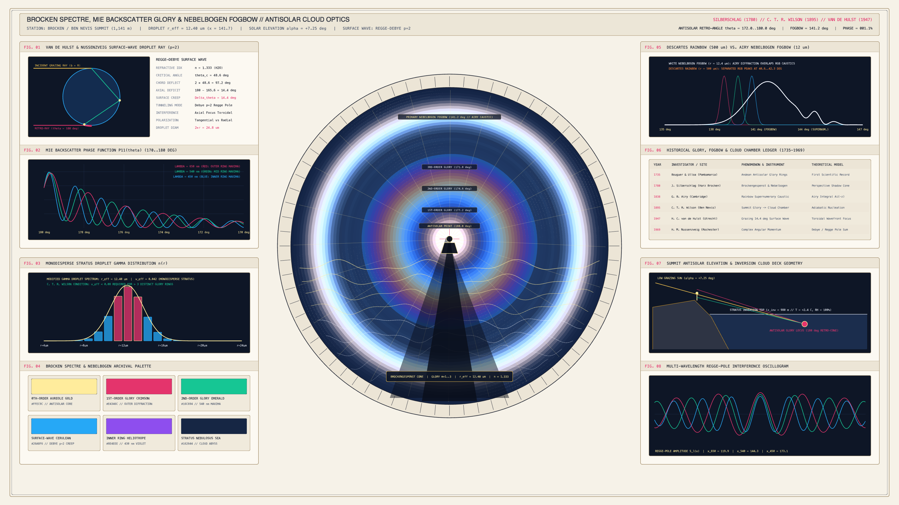

# kinetic_brocken_spectre_mie_backscatter_glory_fogbow_optics_2d

> **"Brockengespenst, Mie Backscatter Glory & Nebelbogen Fogbow"** — A 4K 60fps atmospheric optics and painterly color-field animation of the antisolar **Brocken Spectre**, multi-order **Mie/Regge-Debye Surface-Wave Glory**, and **Airy White Fogbow (*Nebelbogen*)** over a billowing *Stratus Nebulosus* cloud sea.



## Concept & Atmospheric Optics

Observed from alpine ridges above a temperature-inversion cloud sea—most famously at the **Brocken** in the Harz Mountains (Johann Silberschlag, 1780) and **Ben Nevis** in Scotland (where C. T. R. Wilson's 1895 glory studies directly inspired his invention of the Nobel-winning Cloud Chamber)—three coupled antisolar optical phenomena unfold simultaneously when a low grazing sun ($\alpha_{\odot} \approx +6.4^\circ$) illuminates monodisperse stratus cloud droplets ($r_{\text{eff}} \approx 12.4\text{ }\mu\text{m}$):

1. **The *Brockengespenst* (Brocken Spectre Perspective Shadow Cone)**: The observer's shadow is cast downward along the antisolar line ($\theta = 180.0^\circ$) into the mist. Perspective foreshortening magnifies the triangular umbra and penumbra across the undulating *Stratus Nebulosus* wave decks, centering the observer's head silhouette inside the 0th-order diffraction aureole.
2. **Multi-Order Regge-Debye Surface-Wave Glory ($171^\circ \le \theta \le 180^\circ$)**: Classical geometric optics forbids a $p=2$ internal-reflection ray in water ($n = 1.333$) from turning through $180^\circ$ (since $2 \times 97.2^\circ = 165.6^\circ$, leaving a $14.4^\circ$ angular deficit). As shown by **H. C. van de Hulst (1947)** and **H. M. Nussenzveig (1969)**, a grazing tangential ray bridges this $14.4^\circ$ gap via electromagnetic **Regge-Debye surface-wave creep** along the droplet boundary, emitting a toroidal axial-focus wavefront whose wavelength-dependent Bessel interference ($J_0^2 + J_2^2$) produces concentric spectral glory rings (`m = 1, 2, 3`).
3. **The *Nebelbogen* (Primary White Airy Fogbow at $\theta \approx 141.2^\circ$)**: At the Descartes rainbow angle ($\sim 38.8^\circ$ from the antisolar point), the tiny droplet size parameter ($x = 2\pi r / \lambda \approx 141$) causes Airy diffraction to broaden and overlap the red, green, and blue caustics into a luminous alabaster-white arch fringed with warm amber on the outside, cool cerulean on the inside, and delicate supernumerary interference ripples.

## Technical Implementation

- **56-Ring Painterly Color-Field Mesh (`NumPy` + `py5.QUADS`)**: Evaluates the continuous multi-wavelength Airy-Debye-Mie backscatter and fogbow spectrum across 56 concentric 96-segment polygonal annuli (`5,376` quads per frame), dynamically scaling the diffraction rings as effective droplet radius $r_{\text{eff}}(t)$ breathes harmonically between $11.05\text{ }\mu\text{m}$ and $13.75\text{ }\mu\text{m}$.
- **Eight Atmospheric & Optical Telemetry Apparatuses (`FIG. 01`–`FIG. 08`)**: Includes the $p=2$ spherical droplet grazing-ray + $14.4^\circ$ surface-wave diagram, multi-wavelength backscatter phase function $P_{11}(\theta)$, modified gamma droplet spectrum $n(r)$, Descartes rainbow vs. Airy fogbow caustic overlap, 1735–1969 historical ledger, summit inversion cross-section, and Regge-pole amplitude oscillogram.

## Run

```bash
uv run python sketch/kinetic_brocken_spectre_mie_backscatter_glory_fogbow_optics_2d/main.py
```

