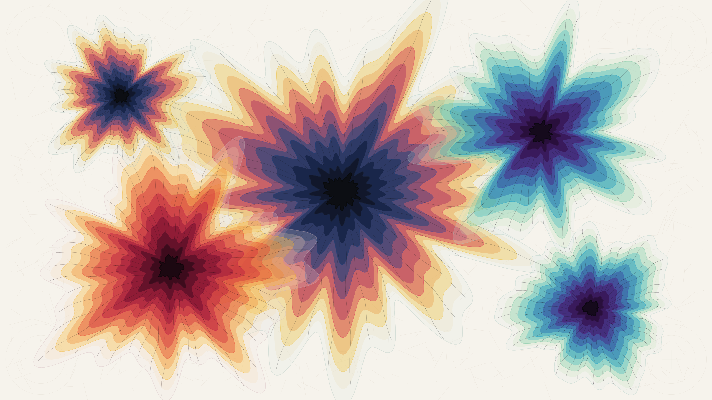

# kinetic_capillary_paper_chromatography_diffusion_2d

Autonomous Generative py5 Media Art Animation (720 frames @ 60 FPS, 12.0s seamless loop, 4K Master).

## Concept

Paper chromatography is a foundational chemical analytical process and aesthetic phenomenon where complex compound inks and botanical dyes placed upon porous cellulose paper fractionate into pure component pigments under capillary solvent advection. Because individual molecular species possess distinct molecular weights, polarities, and partition coefficients between the stationary cellulose matrix and the mobile solvent front ($R_f$ retention factor), an apparently monochromatic ink droplet unravels into an exquisite concentric spectrum of color.

*kinetic_capillary_paper_chromatography_diffusion_2d* visualizes the microfluidic fractionation and Saffman-Taylor capillary fingering of multiple complex ink droplets across textured unbleached cotton cellulose paper. Three distinct historical ink formulations diffuse across the sheet: a classic iron-gall ink core that separates into Prussian blue, alizarin carmine, tartrazine solar amber, and pale celadon solvent; a peacock mineral dye that unfolds into brilliant turquoise, emerald, and deep indigo-violet; and a dragon's blood resin tincture that radiates in coral, vermilion, and rose madder. Over a 12.0s harmonic loop, the concentric pigment fronts undulate and breathe under cyclic capillary absorption, while fine capillary fibrils branch through the porous paper tooth. The artwork is 100% autonomous algorithmic generative art, strictly free of human author signatures or personal seals.

## Anti-Clustering & Diversity Compliance

- **Genre**: *Atmospheric / Painterly / Color Field* (Rotates strictly away from *Organic / Morphogenesis*, *Textile / Calligraphy / Procedural Craft*, and *Physical / Micro-Kinetic*).
- **Background Tone**: Porous unbleached chromatographic cellulose paper ground (`#f6f3ec`), providing organic warmth and tactile tooth.
- **Rendering Primitives**: 12-tier multi-pass translucent pigment glaze polygons, Saffman-Taylor viscous fingering perimeters, feathered radial capillary fibrils, paper tooth pore grain, and cellulose fiber filaments. **Zero particle tracer streams or point clouds.**
- **Strict Anonymity**: 100% autonomous algorithmic generative art. Strictly zero artist signatures, zero seals/hanko (落款・印章), zero monograms, zero initials, and zero personal marks.
- **Palette**: Authentic chromatographic dye fractionation spectra:
  - Porous Cellulose Paper Ground (`#f6f3ec`)
  - Fermented Prussian Indigo & Cobalt (`#18305c` / `#2b4c7e`)
  - Alizarin Carmine Crimson & Rose Madder (`#cd2a4b` / `#e2486a`)
  - Tartrazine Solar Amber & Saffron (`#f2c02d` / `#e89524`)
  - Peacock Cyan & Turquoise (`#1891b6` / `#30b6bc`)
  - Heavy Carbon Black & Gall Nuclei (`#0c0e12` / `#161a24`)

## Mathematical Formulation

1. **Chromatographic Fractionation & Retention Dynamics ($R_f$)**:
   For droplet $d$ with maximum solvent radius $R_{\text{solvent}}$, each pigment band $k$ advances to a radial zone defined by its retention factor $R_{f, k} = v_{\text{pigment}} / v_{\text{solvent}} \in [0.09, 1.00]$:
   $$R_k(\theta, \tau) = R_{\text{solvent}} \cdot R_{f, k} \cdot [1 + A_{\text{breathe}} \sin(\tau + \phi_d)] \cdot \left[ 1 + \sum_{m} a_m \cos(m \theta + \psi_m + \omega_m \tau) \right]$$
   where $\omega_m \in \{-2, -1, 1, 2\}$ ensures a mathematically seamless $C^\infty$ loop over $T = 720$ frames.

2. **12-Tier Optical Glaze Accumulation**:
   Translucent pigment concentration is modeled via additive Beer-Lambert optical glazes ($A_j \approx 45 - 250$), producing natural watercolor edge-darkening and capillary meniscus accumulation.

3. **Saffman-Taylor Viscous Fingering Perturbations**:
   The capillary boundary exhibits multi-harmonic viscous fingering driven by surface tension and porous permeability gradients across modes $m \in \{3, 4, 5, 7, 9, 12, 16, 21\}$.

4. **Radial Capillary Streamer Fibrils**:
   Capillary fibrils stream along the chemical potential gradient from the concentrated core to the leading solvent boundary:
   $$\mathbf{r}_{\text{fib}}(s, \tau) = (1 - s) \mathbf{C}_{\text{core}} + s \mathbf{P}_{\text{solvent}}(\theta) + A_{\text{wave}} \sin(5\pi s + \tau) \mathbf{N}$$

## Specifications

- **Resolution**: $3840 \times 2160$ (4K UHD Master)
- **Duration**: 720 frames (12.0 seconds @ 60 FPS)
- **Audio / Loop**: Mathematically seamless periodic loop ($T = 720$)
- **Encoding**: H.264 / YUV420p / CRF 17 / Preset Slow
