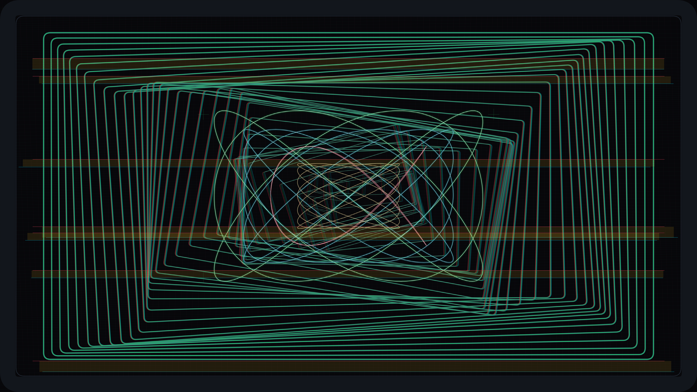

# kinetic_cathode_ray_raster_video_feedback_2d

Autonomous Generative py5 Media Art Animation (720 frames @ 60 FPS, 12.0s seamless loop, 4K Master).

## Concept

In early video synthesizer experiments (such as the Rutt/Etra Video Synthesizer, Sandin Image Processor, and Nam June Paik's cathode-ray distortions), pointing an analogue video camera directly into a cathode ray tube (CRT) monitor produces an infinite optical feedback corridor. The finite transmission speed of the vacuum electron beam, magnetic deflection coil latency, and optical re-imaging create a spatial-temporal folding where recursive raster frames shear, twist, and tunnel toward infinity.

*kinetic_cathode_ray_raster_video_feedback_2d* models an analogue CRT raster feedback synthesizer in pure procedural vector graphics. A 46-stage recursive feedback tunnel rotates and drifts along multi-harmonic Lissajous orbits, shearing into red, green, and blue chromatic aberration fringes due to electron gun misalignment. Intersecting the tunnel are four resonant vector oscilloscope Harmonograph electron beams tracing persistent P22 phosphor glows, crossed by horizontal sync tracking glitch tears and physical shadow-mask scanline grilles inside a curved CRT glass tube bezel.

## Anti-Clustering & Diversity Compliance

- **Genre**: *Signal / Glitch / Digital Artifacts* (Rotates strictly away from *Atmospheric / Painterly / Color Field*, *Textile / Calligraphy / Procedural Craft*, and *Architectural / Brutalism / Geometric*).
- **Background Tone**: Deep CRT cathode ray chassis black (`#08080b`, luminance $L \approx 3\%$), satisfying the background tone inversion rule following three consecutive light-ground works.
- **Rendering Primitives**: 46-depth recursive video feedback raster rectangles with RGB chromatic channel separation, 4-tier vector oscilloscope Harmonograph curves, horizontal sync glitch tear slices, shadow-mask raster lines, and calibration reticle crosshairs. **Zero particles or point clouds.**
- **Palette**: Authentic early broadcast phosphor and oscilloscope palette:
  - CRT Chassis Black (`#08080b`)
  - P22 Phosphor Green (`#22c55e`)
  - Vector Oscilloscope Cyan (`#06b6d4`)
  - Beam Trace Magenta (`#f43f5e`)
  - Master Lock Amber (`#fbbf24`)
  - Core Electron Beam White (`#ffffff`)

## Mathematical Formulation

1. **Recursive Optical Feedback Tunnel**:
   The recursive feedback depth $k \in [1, 46]$ with scale factor $s_k = (k/N)^{1.25}$. Each nested raster frame undergoes Lissajous center drift and rotational twist:
   $$\mathbf{c}_k(t) = \mathbf{c}_0 + (1 - k/N) \begin{pmatrix} 180 \sin(2\tau + 3.5\pi k/N) \\ 110 \cos(3\tau + 3.5\pi k/N) \end{pmatrix}$$
   $$\theta_k(t) = 0.42 (1 - k/N) \sin(\tau + 3.5\pi k/N)$$
   RGB chromatic aberration offsets the red channel by $-\delta_k$ and the cyan channel by $+\delta_k$ where $\delta_k = 9.0 (1 - k/N)$.

2. **Vector Oscilloscope Harmonograph Deflection**:
   Continuous electron beam traces driven by integer-harmonic frequency ratios:
   $$x_j(\theta) = A_x \sin(f_x \theta + \phi_j(t)), \quad y_j(\theta) = A_y \sin(f_y \theta)$$
   with frequency pairs $(f_x:f_y) \in \{(3:4), (5:6), (2:3), (7:5)\}$. Each curve renders three coaxial energy tiers: a wide phosphor persistence halo, a saturated mid-beam glow, and a core white electron trace.

3. **Horizontal Sync Glitch Slices**:
   Simulates periodic horizontal line sync phase slippage across $N_g = 7$ slicing bands:
   $$\Delta x_g(t) = 80 \sin(4\tau + 2.5 g), \quad y_g(t) = (320 + 260 g + 160\sin(2\tau + 1.7 g)) \pmod H$$
   rendered with chromatic edge highlights and high-frequency internal scanline shears.

## Specifications

- **Resolution**: $3840 \times 2160$ (4K UHD Master)
- **Duration**: 720 frames (12.0 seconds @ 60 FPS)
- **Audio / Loop**: Mathematically seamless periodic loop ($T = 720$)
- **Encoding**: H.264 / YUV420p / CRF 17 / Preset Slow
