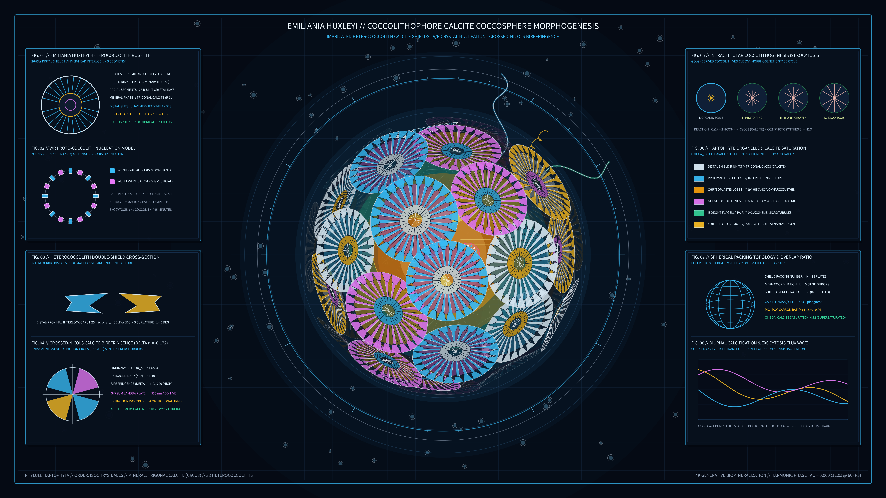

# kinetic_coccolithophore_calcite_coccosphere_morphogenesis_2d



## Concept & Theme

**Marine Phytoplankton Biomineralization: *Emiliania huxleyi* Calcite Coccosphere & Heterococcolith Shield Morphogenesis**

Coccolithophores (*Emiliania huxleyi*, Phylum Haptophyta) are unicellular marine phytoplankton that construct breathtaking spherical armor shells (*coccospheres*) from interlocking wheel-like calcium carbonate ($\text{CaCO}_3$ trigonal calcite) shields called *heterococcoliths*. Each heterococcolith is synthesized intracellularly inside a Golgi-derived coccolith vesicle via an organic base-plate scale and a *proto-coccolith ring* of alternating radial ($R$-unit) and vertical ($V$-unit) calcite crystals, then exocytosed through the cell membrane to interlock into a multi-layered geodesic armor.

This 4K 60fps simulation visualizes:

1. **3D Fibonacci-Goldberg Coccosphere**: 36 interlocking heterococcolith shields distributed across a rotating 3D sphere and depth-sorted back-to-front via Painter's algorithm.
2. **24-Ray T-Shaped Hammer-Head Calcite Shields**: Each shield features a central proximal tube, radial crystal spokes, and distal T-bar hammer-head flanges that breathe and interlock with neighboring shields under cross-polarized birefringent illumination.
3. **Intracellular Haptophyte Protoplast & Flagella**: Through the translucent coccosphere, two parietal golden-brown chrysoplastid lobes, a pulsing Golgi coccolith vesicle synthesizing a nascent proto-coccolith ring, two undulating isokont flagella, and a coiled sensory haptonema are visible.
4. **Eight Biomineralization & Crystallography Apparatuses**: Four full-flank dark glassmorphic scientific panels detailing the single heterococcolith rosette plan view, Young & Henriksen (2003) $V/R$ crystal nucleation ring, double-shield interlock cross-section, crossed-Nicols uniaxial negative birefringence ($\Delta n = -0.172$) extinction cross, four-stage intracellular coccolithogenesis cycle, organelle specification, spherical packing topology, and diurnal calcification waveforms.

Completely free of human author signatures, seals (*hanko*), or watermarks.

## Palette

- **Deep Pelagic Photic-Abyssal Slate**: `#050a14`
- **Biomineral Calcite Ice White**: `#e0f2fe`
- **Polarized Birefringent Cyan**: `#38bdf8`
- **Haptophyte Chrysoplastid Gold & Amber**: `#fbbf24` / `#f59e0b`
- **Gypsum Plate Interference Rose-Amethyst**: `#e879f9`
- **Chlorophyll & Flagellar Emerald**: `#34d399`

## Run

```bash
uv run python sketch/kinetic_coccolithophore_calcite_coccosphere_morphogenesis_2d/main.py
```

