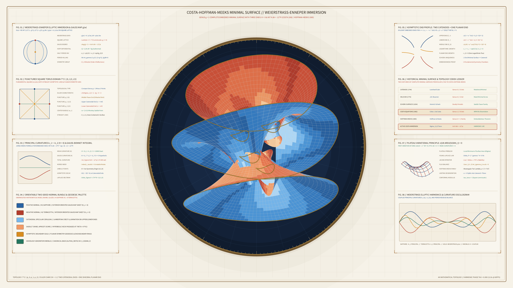

# Kinetic Costa Minimal Surface & Weierstrass-Enneper Immersion 2D

## Concept & Theme
Autonomous generative media art in the **Mathematical / Abstract Topology** genre exploring Celso José da Costa's 1982 Complete Embedded Minimal Surface of Genus $g = 1$ with Three Punctures ($\Sigma_{1,3} = T^2 \setminus \{p_0, p_1, p_2\}$) and David Hoffman & William H. Meeks III's 1985 proof of embeddedness via the Weierstrass-Enneper elliptic $\wp$-function representation, executed on warm Oberwolfach & Göttingen mathematical drafting vellum (`#f6f2e8`).

For over two centuries (Euler's 1744 Catenoid and Meusnier's 1776 Helicoid), the plane, catenoid, and helicoid were the only known complete embedded minimal surfaces in $\mathbb{R}^3$ of finite topological type. Costa's surface is parametrized on the square lattice torus $\mathbb{C} / (\mathbb{Z} \oplus i\mathbb{Z})$ via the Weierstrass elliptic function $\wp(w)$ and $\zeta$-function, possessing identical zero mean curvature $H = \frac{1}{2}(\kappa_1 + \kappa_2) = 0$ everywhere and total Gaussian curvature $\int_{\Sigma} K\,dA = -12\pi$. It combines an upper catenoidal funnel end ($E_+$), a lower catenoidal funnel end ($E_-$), and a dihedral-warped middle planar end ($E_0$) joined through four $D_2$-symmetric hyperbolic saddle neck tunnels, completely free of author signatures, seals, or watermarks.

## Algorithmic & Mathematical Highlights
- **3D Multi-Sheet Minimal Immersion & 14-Slab Painter's Depth Sorting**: 4,600+ oriented isothermal quad facets spanning the upper catenoidal end, lower catenoidal end, dihedral middle planar skirt ($z \sim A \cos(2\theta)/r^2$), and four hyperbolic neck handles, sorted back-to-front by camera $Z$-depth and batch-rendered via `py5.QUADS` / `py5.vertices`.
- **Two-Sided Unit Normal Bundle Coloration**: Facets are shaded across 7 Lambertian + specular buckets according to the sign of their camera-space normal component $N_z$, alternating between Positive Normal Prussian Sapphire (`#2862a2` / `#76b8ee`) and Negative Normal Venetian Terracotta (`#b23c2c` / `#f29a66`).
- **Eight Scholarly Telemetry Apparatuses**:
  1. `FIG. 01`: Weierstrass-Enneper meromorphic immersion & stereographic Gauss map $g(w) = A / \wp'(w)$ on $S^2$.
  2. `FIG. 02`: Punctured square torus fundamental domain $T^2 \setminus \{0, \frac{1}{2}, \frac{i}{2}\}$ with straight asymptotic reflection lines.
  3. `FIG. 03`: Principal curvatures $\kappa_1 = -\kappa_2$ ($H = 0$) & Jorge-Meeks Gauss-Bonnet integral $\int K\,dA = -2\pi(2g + 2k - 2) = -12\pi$.
  4. `FIG. 04`: Oberwolfach mathematical model two-sided normal bundle & geodesic palette.
  5. `FIG. 05`: Three-end asymptotic geometry ($z_{\pm} \sim \pm c \ln r$ catenoids vs. $z_0 \sim a \cos(2\theta)/r^2$ planar end).
  6. `FIG. 06`: Historical minimal surface codex ledger (Euler 1744, Meusnier 1776, Scherk 1834, Costa 1982, Hoffman-Meeks 1985).
  7. `FIG. 07`: Plateau soap-film variational principle $\frac{d}{dt}\text{Area}(\Sigma_t)|_{t=0} = -2\int \langle \vec{V}, H\vec{N}\rangle dA = 0$.
  8. `FIG. 08`: Weierstrass elliptic $\wp(w)$ harmonics and principal curvature oscillogram.

