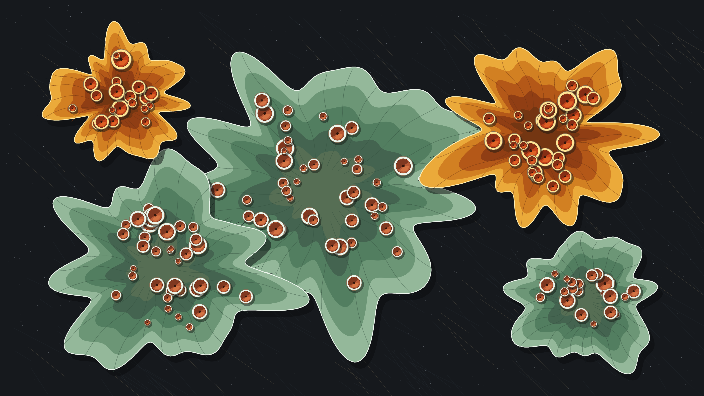

# kinetic_crustose_lichen_apothecia_symbiosis_2d

Autonomous Generative py5 Media Art Animation (720 frames @ 60 FPS, 12.0s seamless loop, 4K Master).

## Concept

Lichens represent one of nature's most resilient evolutionary symbioses—a mutualistic partnership between a filamentous fungus (*mycobiont*) providing mechanical structure, mineral absorption, and shelter, and photosynthetic algae or cyanobacteria (*photobiont*) synthesizing carbohydrates from solar irradiance. Colonizing extreme alpine granitic slabs and coastal basalt boulders, lichens expand at microscopic rates of millimeters per decade, developing concentric growth zonation fronts and cup-shaped reproductive organs called *apothecia*.

*kinetic_crustose_lichen_apothecia_symbiosis_2d* models the morphogenesis and diurnal breathing of symbiotic crustose and foliose lichen colonies across a weathered alpine basalt substrate. Two distinct lichen species coexist in direct spatial competition: the vibrant golden sunburst lichen (*Xanthoria elegans*) with rich saffron margins and fiery ochre medulla, and the pale celadon green shield lichen (*Parmelia sulcata*) with chalky mineral white rims. Over a 12.0s harmonic loop, the colonies expand rhythmically, unfurling concentric crenulated lobal perimeters while dozens of elevated terracotta spore chalices breathe, catching grazing raking sunlight with deep 3D relief. The artwork is 100% autonomous algorithmic generative media art, strictly free of human author signatures, name seals, or personal marks.

## Anti-Clustering & Diversity Compliance

- **Genre**: *Organic / Morphogenesis* (Rotates strictly away from *Textile / Calligraphy / Procedural Craft*, *Physical / Micro-Kinetic*, and *Architectural / Brutalism / Geometric*).
- **Background Tone**: Deep weathered basalt slate substrate (`#16191d`), featuring quartz crystalline cleavage veins and pyroxene mineral flecks.
- **Rendering Primitives**: Multi-harmonic crenulated lobed polygons, concentric growth zonation rings, raised apothecia cup relief with dual-pass concave shadowing and specular highlights, marginal rhizine anchoring filaments, and geological rock fissures. **Zero particle tracer streams or point clouds.**
- **Strict Anonymity**: 100% autonomous algorithmic generative art. Strictly zero artist signatures, zero seals/hanko (落款・印章), zero monograms, zero initials, and zero personal marks.
- **Palette**: Authentic mineral and botanical pigments:
  - Deep Weathered Basalt Slate (`#16191d`)
  - Saffron & Amber Sunburst Lichen (*Xanthoria*, `#eba83a` / `#d28022`)
  - Pale Celadon & Sage Shield Lichen (*Parmelia*, `#94b89a` / `#6c9676`)
  - Terracotta & Burnt Ochre Spore Discs (`#b85a36` / `#743612`)
  - Chalk Mineral White Margin Rims (`#eef6ee` / `#fffae6`)
  - Crystalline Quartz Micro-Veins (`#a5916e`)

## Mathematical Formulation

1. **Colony Crenulated Perimeter Kinematics**:
   For colony $c$ with base radius $R_c$, the boundary radius at polar angle $\theta \in [0, 2\pi)$ undulates according to a Fourier spectrum of harmonic integer frequencies $m \in \{3, 4, 5, 7, 9, 11, 14\}$:
   $$R(\theta, \tau) = R_c \cdot [1 + A_b \sin(\tau + \phi_c)] \cdot \left[ 1 + \sum_{m} a_m \cos(m \theta + \phi_m + \omega_m \tau) \right]$$
   where $\omega_m \in \{-2, -1, 1, 2\}$ are integer multipliers of the fundamental cycle $\tau = 2\pi t / T$, guaranteeing mathematical $C^\infty$ periodicity over $T = 720$ frames.

2. **Concentric Zonation Growth Fronts**:
   Each colony generates concentric zonation rings with radial scaling fractions $f_j \in [0.32, 1.00]$, representing the ontogenetic transition from outer active photosynthetic margins to inner senescent medulla.

3. **Apothecia Spore Chalice Relief**:
   Each apothecium at position $(x_k, y_k)$ possesses a raised outer rim of radius $2 r_k$ and a concave inner hymenium disc of radius $1.5 r_k$. Analytical dual-light shading applies an ambient occlusion contact shadow on the upper-left and an internal specular reflection on the lower-right:
   $$I_{\text{hymenium}}(\phi) = I_{\text{base}} - \Delta I_{\text{shadow}} \cdot \max(0, \cos(\phi - \phi_{\text{light}})) + \Delta I_{\text{reflect}} \cdot \max(0, -\cos(\phi - \phi_{\text{light}}))$$

4. **Radial Hyphae Segmentation Lobes**:
   Radial hyphal boundaries divide the colony into distinct physiological lobes, undulating with transverse traveling waves:
   $$\mathbf{r}_{\text{rib}}(s, \tau) = (1 - s) \mathbf{C}_{\text{center}} + s \mathbf{P}_{\text{margin}} + A_{\text{wave}} \sin(3\pi s + \tau) \mathbf{N}$$

## Specifications

- **Resolution**: $3840 \times 2160$ (4K UHD Master)
- **Duration**: 720 frames (12.0 seconds @ 60 FPS)
- **Audio / Loop**: Mathematically seamless periodic loop ($T = 720$)
- **Encoding**: H.264 / YUV420p / CRF 17 / Preset Slow
