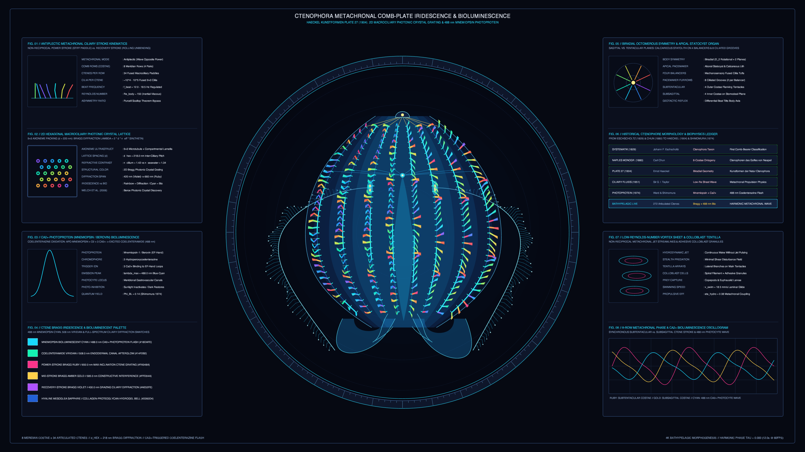

# kinetic_ctenophora_metachronal_comb_plate_bioluminescence_2d

## Overview

- **Date**: 2026-11-05
- **Genre**: Organic / Morphogenesis
- **Format**: 4K 60fps Seamless Loop Animation (3840×2160, 720 frames / 12.0s)
- **Background**: Dark — Deep Bathypelagic Darkfield Obsidian (`#060912`)

## Concept & Biophysical Foundation

Inspired by **Ernst Haeckel's** *Kunstformen der Natur* Plate 27 (*Ctenophora*, 1904), **Carl Chun's** *Die Ctenophoren des Golfes von Neapel* (1880), **Sir G. I. Taylor's** low-Reynolds-number metachronal ciliary hydrodynamics (1951), **Victoria Welch et al.'s** discovery of 2D photonic-crystal structure in ctenophore comb rows (2006), and **Osamu Shimomura & Ward's** isolation of the $\text{Ca}^{2+}$-regulated photoprotein *mnemiopsin* (1974):

1. **Antiplectic Metachronal Ciliary Propulsion ($8\text{ Costae} \times 34\text{ Ctenes} = 272\text{ Paddles}$)**:
   - Coordinated by the aboral **apical statocyst organ** (a calcareous statolith balanced on 4 mechanosensory *balancer* tufts feeding 8 ciliated pacemaker furrows), 272 transverse comb plates (*ctenes*) beat in an antiplectic metachronal wave:
     $$\Phi_{m,k}(t) = 3\omega t - \kappa k + \phi_m$$
   - Each paddle executes a non-reciprocal cycle—a stiff, high-drag **power stroke** sweeping toward the aboral pole followed by a flexed, low-drag **recovery stroke** unrolling toward the oral lobes—bypassing Purcell's Scallop Theorem.

2. **2D Hexagonal Macrociliary Bragg Iridescence vs. $488\text{ nm}$ Photoprotein Bioluminescence**:
   - **Structural Iridescence**: Each comb plate comprises $\sim 10^4\text{–}10^5$ fused `9+3` macrocilia packed in a 2D hexagonal photonic crystal lattice ($d_{\text{hex}} \approx 218\text{ nm}$). As the paddle angle $\theta_{m,k}(t)$ sweeps through its stroke, constructive Bragg diffraction $\lambda = 2 d_{\text{hex}} n_{\text{eff}} \sin\theta_{m,k}$ shifts continuously from recovery-stroke violet (`420 nm`) through cyan and emerald to power-stroke gold and ruby-magenta (`660 nm`).
   - **Intrinsic Bioluminescence**: Underlying the 8 meridian comb rows, the endodermal gastrovascular canal network (stomodeum, infundibulum, adradial and meridional canals) pulses with traveling $\text{Ca}^{2+}$-triggered *mnemiopsin/berovin* coelenterazine oxidation waves peaking at $\lambda_{\max} = 488.0\text{ nm}$.

