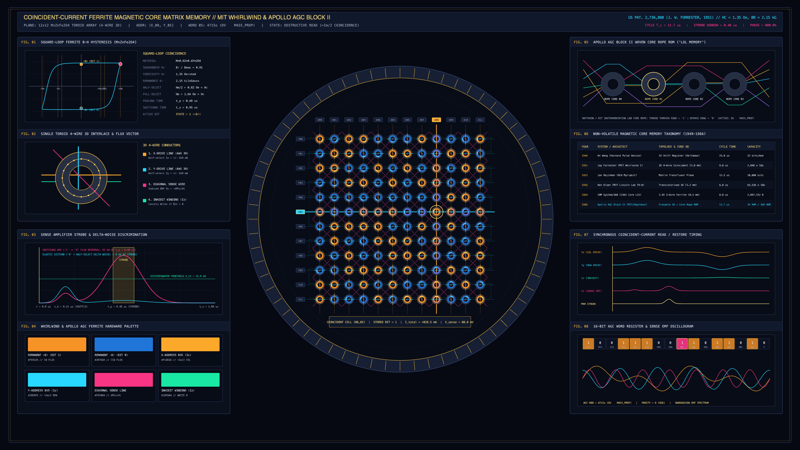

# kinetic_ferrite_magnetic_core_matrix_coincident_current_memory_2d

> **"Coincident-Current Ferrite Magnetic Core Matrix Memory"** — A 4K 60fps electromagnetic hardware and cybernetic signal animation of Jay Forrester's 1951 4-wire 3D Coincident-Current Ferrite Toroid Matrix (`US Patent 2,736,880`) and the MIT Instrumentation Lab / Raytheon **Apollo Guidance Computer (AGC Block II)** erasable core plane and woven **Core Rope ROM**.



## Concept & Electromagnetic Physics

Before monolithic semiconductor RAM, high-reliability digital computers—from **MIT Project Whirlwind I (1951)** and **TX-0 (1956)** to the **Apollo Guidance Computer (AGC Block II, 1966)**—stored binary words as clockwise (`+Br`, Bit `1`) or counter-clockwise (`-Br`, Bit `0`) remanent magnetic flux inside microscopic sintered manganese-zinc ferrite toroids ($\text{Mn}_{0.6}\text{Zn}_{0.4}\text{Fe}_2\text{O}_4$).

This piece visualizes the complete 4-wire 3D coincident-current read/restore cycle on deep MIT Whirlwind & Apollo AGC backplane obsidian (`#060912`):

1. **12×12 Sintered Ferrite Toroid Plane & 4-Wire Interlace (`X`, `Y`, `Sense`, `Inhibit`)**: 144 toroidal cores inside a 64-pin ceramic carrier frame are threaded orthogonally by 12 vertical $X$-Address lines (`#fca82a`), 12 horizontal $Y$-Address lines (`#28d8fe`), a serpentine horizontal Inhibit winding (`#18e8a4`), and a diagonal checkerboard noise-canceling Sense wire (`#f83484`).
2. **Square-Loop $B\text{–}H$ Coincidence Threshold ($H_m / 2 < H_c < H_m$)**: Driving a selected row $Y_r$ and column $X_c$ with half-select current pulses ($I_m / 2 = 410\text{ mA}$, producing $H_m / 2 = 0.82\text{ Oe} < H_c = 1.35\text{ Oe}$) leaves all half-selected cores on that row and column in an elastic minor-loop excursion. Only at the exact intersection $(X_c, Y_r)$ does the total magnetomotive force reach $H_m = 1.64\text{ Oe} > H_c$, triggering a Barkhausen domain-wall avalanche reversal.
3. **Destructive Read, Strobe Discrimination & Restore Cycle**: If the addressed core held a `1` (`+Br`), flipping to `-Br` induces a $65\text{ mV}$ peaking EMF pulse ($V_{\text{sense}} = -d\Phi/dt$) at $t_p = 0.48\text{ }\mu\text{s}$, cleanly discriminated from half-select delta shuttle noise ($< 9\text{ mV}$) during the narrow Sense Amplifier Strobe window, followed immediately by a `-Im/2` Restore/Write pulse (gated by the emerald Inhibit winding when restoring `0`).
4. **Apollo AGC Block II Woven Core Rope ROM (`FIG. 05`) & `LUMINARY 116` Register (`FIG. 08`)**: Contrasts erasable coincident-current RAM with Raytheon's high-density read-only Core Rope where sense wires physically thread through (`1`) or bypass (`0`) permalloy switch cores to encode 16-bit Lunar Module guidance instructions (`TCF`, `CA`, `AD`, `CCS`, `EXTEND`, `DV`, `DCA`, `DAS`).

## Technical Implementation

- **Vectorized Toroid & Over/Under Wire Bridge Batching (`NumPy` + `py5`)**: All 144 multi-ring ferrite toroids and rotating azimuthal magnetic domain arcs are batched by state color into `py5.QUADS` / `py5.vertices` arrays, overlaid with alternating over-pass wire bridges (`py5.lines`) for authentic woven depth.
- **Exact 24-Cycle Seamless Loop**: Over $720$ frames ($12.0\text{ s}$ at $60\text{ fps}$), the address decoder executes $24$ complete `READ -> STROBE -> RESTORE` memory cycles ($30$ frames per cycle), traversing all 12 rows and columns in a deterministic modular sequence.

## Run

```bash
uv run python sketch/kinetic_ferrite_magnetic_core_matrix_coincident_current_memory_2d/main.py
```

