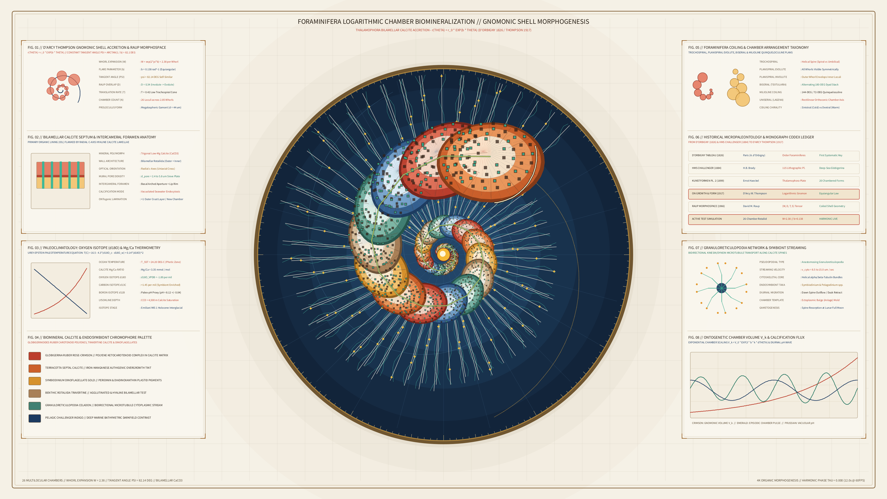

# Kinetic Foraminifera Logarithmic Chamber Biomineralization 2D

## Concept & Theme
Autonomous generative media art in the **Organic / Morphogenesis** genre exploring marine Foraminifera (*Thalamophora* / *Rotaliida* / *Globigerinacea*) multilocular calcite shell morphogenesis, D'Arcy Wentworth Thompson's gnomonic logarithmic spiral accretion laws (*On Growth and Form*, 1917; David M. Raup's 1966 coiled-shell morphospace), Alcide d'Orbigny's 1826 *Tableau méthodique*, and Ernst Haeckel's *Kunstformen der Natur* Plate 2 (*Thalamophora*), executed on warm Victorian naturalist monograph vellum (`#f5f1e6`).

Beginning from a central embryonic proloculus (megalospheric gamont chamber), 32 successive globular and crescentic low-Mg calcium carbonate ($\text{CaCO}_3$) chambers (*loculi*) accrete along a self-similar equiangular spiral $r(\theta) = r_0 e^{b\theta}$. Each chamber is bounded by a double-walled bilamellar septum pierced by an arched basal aperture (*foramen*, "opening") through which a continuous turquoise-and-gold cytoplasmic stream flows, while delicate radiating calcite spines and anastomosing *granuloreticulopodia* extend into the surrounding marine boundary layer, flanked by eight micropaleontology and paleoclimatology telemetry apparatuses across four balanced flank cards, completely free of author signatures, seals, or watermarks.

## Algorithmic & Mathematical Highlights
- **D'Arcy Thompson Gnomonic Spiral Accretion**: 32 chambers scale self-similarly along $r_k = r_0 e^{b \theta_k}$ ($b = 0.194\text{ rad}^{-1}$, whorl expansion rate $W = e^{2\pi b} = 3.38$) with constant spiral tangent angle $\psi = \arctan(1/b)$.
- **Bilamellar Calcite Wall & Sutural Imbrication**: Each chamber is rendered in natural ontogenetic accretion order ($k = 0 \dots 31$) across four concentric mineral zones (`py5.QUADS` / `py5.vertices`) with sutural costae bridges (*ponticuli*), perforated mural pore sieve arrays, and an arched terminal umbilical-extraumbilical aperture lip.
- **Acicular Calcite Spines & Anastomosing Granuloreticulopodia**: Vectorized radial spines (`py5.lines`), sinuous cytoplasmic microtubule streams, and bidirectional *Symbiodinium* dinoflagellate symbiont granules (`py5.QUADS`).
- **Eight Scholarly Telemetry Apparatuses**:
  1. `FIG. 01`: D'Arcy Thompson gnomonic shell accretion & Raup $(W, D, T, S)$ morphospace.
  2. `FIG. 02`: Bilamellar calcite septum & intercameral foramen anatomy (Primary Organic Lining + radial $c$-axis hyaline lamellae).
  3. `FIG. 03`: Paleoclimatology $\delta^{18}\text{O}$ Urey-Epstein paleothermometry & exponential $\text{Mg/Ca}$ calibration curves.
  4. `FIG. 04`: Biomineral calcite & endosymbiont chromophore palette (*Globigerinoides ruber* polyene ketocarotenoids, *Symbiodinium* peridinin gold, travertine calcite).
  5. `FIG. 05`: Foraminifera coiling & chamber arrangement taxonomy (Trochospiral, Planispiral Evolute, Biserial, Milioline).
  6. `FIG. 06`: Historical micropaleontology codex ledger (d'Orbigny 1826, *H.M.S. Challenger* 1884, Haeckel 1899, Thompson 1917, Raup 1966).
  7. `FIG. 07`: Granuloreticulopodia microtubule network & diurnal dinoflagellate symbiont streaming.
  8. `FIG. 08`: Ontogenetic chamber volume $V_k = V_0 e^{3b\theta_k}$ & episodic vacuolar pH calcification flux.

