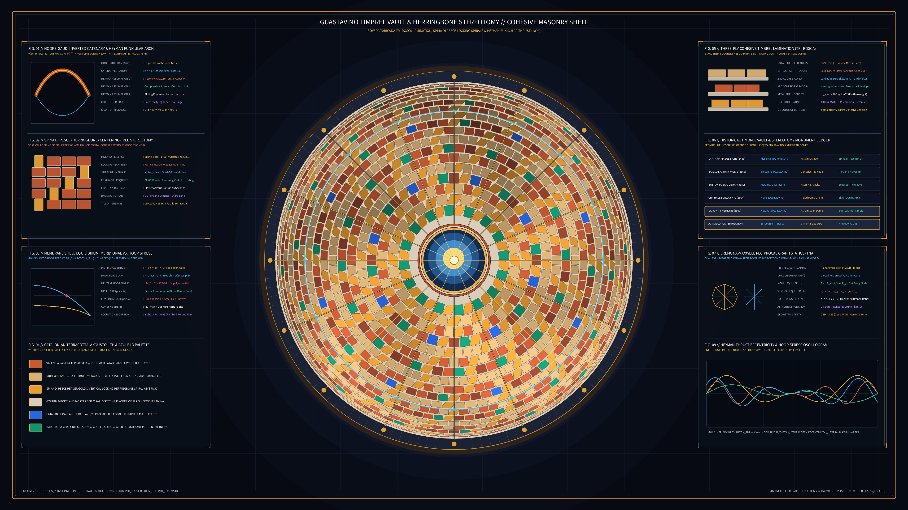

# Kinetic Guastavino Timbrel Vault & Herringbone Stereotomy 2D

## Concept & Theme
Autonomous generative media art in the **Architectural / Brutalism / Geometric** genre exploring Rafael Guastavino Sr. & Jr.'s Cohesive Timbrel Vaulting (*Bóveda Tabicada*, *Essay on the Theory and History of Cohesive Construction*, 1892; City Hall Subway Station NYC 1904; Cathedral of St. John the Divine dome 1909), Filippo Brunelleschi's self-supporting *spina di pesce* (herringbone brick courses of Santa Maria del Fiore, Florence 1420–1436), Antoni Gaudí's catenary funicular stereotomy, and Jacques Heyman's Lower-Bound Safe Theorem of Masonry (*The Stone Skeleton*, 1966), executed on deep structural blueprint & vault obsidian slate (`#070a12`).

Seen in wide-angle upward zenithal projection, a monumental circular timbrel cupola spans between 16 perimeter buttress piers and a central glazed lantern oculus. Eighteen concentric courses of thin Catalonian *rasilla* terracotta and Rumford *Akoustolith* buff tiles are laid in interlocking running bond and counter-spiraling *spina di pesce* (herringbone) courses with crisp gypsum and Portland cement mortar bed joints. Every eighth tile slot along 16 loxodromic spirals is a canted vertical locking header brick that clamps the unfinished horizontal ring against inward sliding without wooden centering (*cimbra*), while 16 meridian groin ribs and the golden-ratio neutral hoop circle at $\phi_0 = 51.83^\circ$ ($\cos\phi_0 = 1/\varphi \approx 0.618$) visualize the membrane transition from upper biaxial compression to lower tension-ring containment, completely free of author signatures, seals, or watermarks.

## Algorithmic & Mathematical Highlights
- **18-Course Timbrel & *Spina di Pesce* Herringbone Stereotomy**: Spherical dome foreshortening ($r(\phi) = R \sin\phi$) across 18 courses with running-bond stagger, mortar bed joint insets, and 16 counter-clockwise herringbone locking spirals batched by `(material_idx, shade_bucket)` via `py5.QUADS` / `py5.vertices`.
- **Golden-Ratio Membrane Shell Equilibrium**: Visualizes meridional thrust $N_\phi = -qR / (1 + \cos\phi)$ and hoop force $N_\theta = qR (\cos\phi - \frac{1}{1+\cos\phi})$, highlighting the exact neutral hoop locus $\cos^2\phi_0 + \cos\phi_0 - 1 = 0 \implies \phi_0 = 51.827^\circ$.
- **Three-Ply *Tri-Rosca* Oculus Cutaway**: Stepped concentric delamination rings around the central glazed skylight oculus revealing the 1st gypsum layer, 2nd skewed Portland cement layer, and 3rd structural extrados course.
- **Eight Scholarly Telemetry Apparatuses**:
  1. `FIG. 01`: Hooke-Gaudí inverted catenary $y(x) = \frac{H_0}{w}(1 - \cosh\frac{wx}{H_0})$ & Heyman middle-third (*kern*) envelope.
  2. `FIG. 02`: Brunelleschi-Guastavino *spina di pesce* centering-free herringbone locking bond.
  3. `FIG. 03`: Membrane shell meridional ($N_\phi$) vs. hoop ($N_\theta$) stress curves and $\phi_0 = 51.83^\circ$ zero-crossing.
  4. `FIG. 04`: Catalonian *rasilla* terracotta, Rumford *Akoustolith* buff, gypsum mortar, and *azulejo* glaze palette.
  5. `FIG. 05`: Three-ply cohesive timbrel lamination (*tri-rosca*) cross-section.
  6. `FIG. 06`: Historical timbrel vault & masonry stereotomy ledger (Florence Duomo 1436 to St. John the Divine 1909).
  7. `FIG. 07`: Cremona-Maxwell reciprocal graph statics ($\Gamma$ form diagram & $\Gamma^*$ dual force polygon).
  8. `FIG. 08`: Heyman thrust-line eccentricity $e(\phi)/(t/6)$ and hoop stress oscillogram.

