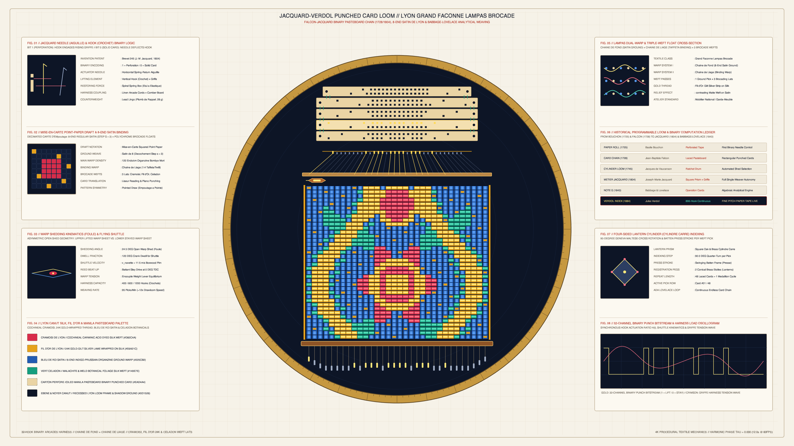

# kinetic_jacquard_verdol_punched_card_lampas_brocade_loom_2d

## Overview

- **Date**: 2026-11-05
- **Genre**: Textile / Calligraphy / Procedural Craft
- **Format**: 4K 60fps Seamless Loop Animation (3840×2160, 720 frames / 12.0s)
- **Background**: Light — Warm Lyon *Canut* *Mise-en-Carte* Point-Paper Vellum (`#f6f2e8`)

## Concept & Textile Mechanics

Inspired by **Joseph-Marie Jacquard's** 1804 programmable silk loom (*Métier Jacquard*, Brevet 245), **Basile Bouchon** (1725) and **Jean-Baptiste Falcon's** (1728) laced binary punched cards, **Philippe de Lasalle's** 18th-century Lyon *Grand Façonné Lampas* botanical silk-and-gold brocades, and **Charles Babbage & Ada Lovelace's** 1843 *Note G* on the Analytical Engine:

1. **Binary Punched Card Chain (*Cartons Perforés*) & Hook Selection Logic**:
   - An endless chain of 48 laced manila pasteboard cards advances over the rotating 4-sided lantern prism (*Cylindre Carré*).
   - For each weft pick $r$ and warp column $c \in \{0, \dots, 31\}$, a binary perforation $B_{r,c} \in \{0, 1\}$ governs whether the horizontal spring-loaded needle (*Aiguille*) passes through the card hole (`1`), allowing the vertical brass hook (*Crochet*) to engage the rising *Griffe* knife bar and lift its harness cord (*Arcade*), or is deflected by solid pasteboard (`0`), leaving the warp end down.

2. **Lyon *Grand Façonné Lampas* Dual-Warp & Triple-Weft Brocade Structure**:
   - Beneath the perforated boxwood Comber Board (*Planche d'Empoutage*) and the flying boxwood shuttle (*Navette*) traversing the open warp shed (*Foule*), the woven *Lampas* brocade unfurls between golden selvedges (*Lisières*).
   - Ground areas are woven in an **8-end regular satin (*Satin de 8*, step $s = 3$)** where $(3r + c) \equiv 0 \pmod 8$ forms golden binding tie points (*Points de Liage*) across the royal indigo *Chaîne de Fond* warp (`#225cb2`).
   - Figure areas are brocaded by three polychrome weft shuttles (*Lats de Broché*)—**Fil d'Or 24K** gold-wrapped thread (`#e6a21c`), **Cramoisi de Lyon** cochineal crimson silk (`#d82c4a`), and **Vert Céladon** botanical malachite silk (`#149e7e`)—counterbalanced at the bottom by 32 oscillating lead lingoes (*Plombs de Rappel*).

