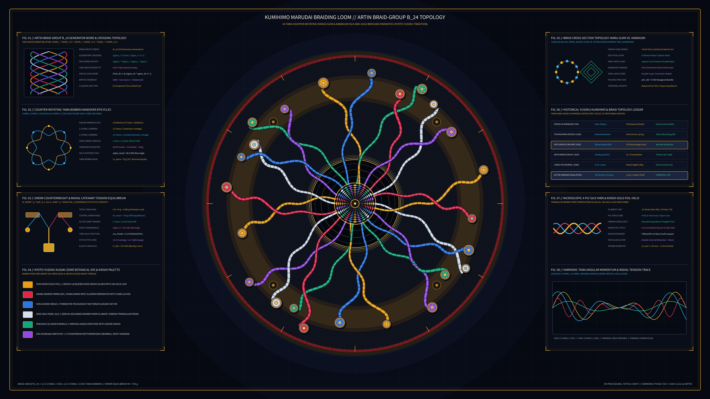

# Kinetic Kumihimo Marudai Braiding Loom & Braid-Group Topology 2D

## Concept & Theme
Autonomous generative media art in the **Textile / Calligraphy / Procedural Craft** genre exploring traditional Japanese *Kumihimo* (組紐) *Marudai* (丸台) 24-*Tama* (玉) silk-and-gold braiding kinematics and Emil Artin's Braid Group $B_{24}$ topological generator choreography (*Theorie der Zöpfe*, 1925), inspired by Kyoto *Yūsoku Kumihimo* (*Domyo* tradition, Heian–Edo period samurai *odoshi-ge* armor lacing and *obijime* cords) and executed on deep Kyoto *Urushi* black-indigo lacquer (`#060912`).

Around the polished circular *Kagami* (鏡, mirror) disk of a traditional wooden *Marudai* braiding stand, 24 weighted wooden bobbins (*Tama* 玉) arranged in 8 counter-rotating triad groups orbit and exchange slots along coupled epicyclic trajectories. Each *Tama* feeds a multi-ply twisted *Bombyx mori* silk or *Kinshi* (金糸, 24K gold-leaf wrapped *kozo* paper) cord radially inward across the *Tori-guchi* lip and down into the central *Heso* (臍, navel) aperture under the equilibrium tension of a suspended brass *Omori* (重り) counterweight. By sorting 624 ribbon segments by their instantaneous Artin generator crossing height $z_i(r, \tau)$ and rendering each cord as a 3D cylindrical multi-filament ribbon with $S/Z$ ply striations, the radial tension web condenses at the center into an intricately interlocked 3D tubular *Kongō-gumi* (金剛組) and *Karakumi* (唐組) brocade cord, completely free of author signatures, seals, or watermarks.

## Algorithmic & Mathematical Highlights
- **Artin Braid Group $B_{24}$ Choreography**: 12 clockwise $S$-chiral (+1) and 12 counterclockwise $Z$-chiral (-1) *Tama* carriers execute coupled figure-eight handover epicycles around the 24 *Kiri-komi* perimeter notches while satisfying the Yang-Baxter triple-strand braid relation $\sigma_i \sigma_{i+1} \sigma_i = \sigma_{i+1} \sigma_i \sigma_{i+1}$.
- **Over-Under Depth-Sorted 3D Silk Ribbon Synthesis**: 624 curved ribbon segments (`py5.QUADS` / `py5.vertices`) with dark under-shadow borders, oblique $S/Z$ twist ply striations (`py5.lines`), and fibroin specular ridges are sorted back-to-front across 12 depth slabs.
- **Central 9-Tier Tubular *Kongō-gumi* Rosette**: Vectorized diamond-chevron facets inside the central *Heso* well with radial foreshortening and brass *Omori* counterweight suspension collar.
- **Eight Scholarly Telemetry Apparatuses**:
  1. `FIG. 01`: Artin Braid Group $B_{24}$ generator word & Yang-Baxter crossing diagram.
  2. `FIG. 02`: Counter-rotating $S$-chiral / $Z$-chiral *Tama* handover epicycles.
  3. `FIG. 03`: *Omori* counterweight & radial catenary tension equilibrium ($M_{\Omega} g = \sum m_T g \sin\alpha_i$).
  4. `FIG. 04`: Kyoto *Yūsoku Kusaki-zome* botanical dye & 24K *Kinshi* gold-foil palette.
  5. `FIG. 05`: Cross-sectional braid topology (*Maru-gumi*, *Kaku-gumi*, and *Karakumi*).
  6. `FIG. 06`: Historical *Kumihimo* codex & topological link invariant ledger (Nara *Shōsō-in* 756 CE to Jones polynomial $V_L(t)$).
  7. `FIG. 07`: Microscopic 4-ply *Bombyx mori* silk yarn & helical *Kinshi* gold-foil wrap geometry.
  8. `FIG. 08`: Harmonic *Tama* angular momentum & radial tension oscillogram.

