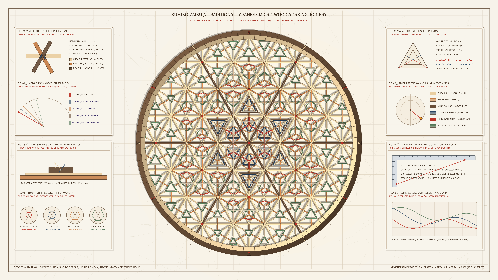

# kinetic_kumiko_woodworking_asanoha_joinery_2d



## Concept & Theme

**Traditional Japanese Kumiko-zaiku (組子細工) Precision Micro-Woodworking Joinery & Kiku-jutsu (規矩術) Architectural Trigonometry**

Originating in Japan's Asuka period (7th century) and brought to extraordinary geometric refinement in Hida-Takayama and Okawa, *Kumiko-zaiku* is the craft of assembling thousands of hand-planed, bevel-chiseled wood laths (*ha-ita* 葉板) into self-locking geometric lattices without a single nail or drop of glue. Artisans plane thin strips of cypress and cedar to micron tolerances and bevel their ends at exact trigonometric angles ($15^\circ, 22.5^\circ, 30^\circ, 45^\circ, 60^\circ$) using angled chisel blocks (*katagi* 片木) and precision hand planes (*kanna* 鉋).

This 4K 60fps animation visualizes a monumental circular Kumiko transom panel (*ensō-ranma* 円窓欄間) set against warm backlit Echizen kozo shoji paper (`#f7f3ea`):

1. **Mitsukude-Kikkō Primary Lattice**: Three-axis ($0^\circ, 60^\circ, 120^\circ$) continuous laths interlocking via precision half-lap *mitsukude-gumi* joints.
2. **Concentric Multi-Motif Tsukeko Infill**:
   - **Core**: *Kasane-Asanoha* (layered hemp leaf) with Hon-Shu vermilion lacquer and Aizome indigo-dyed cypress collars.
   - **Inner Ring**: Classic *Asanoha* with dual counter-sliding *Goma-gara* (sesame rosette) locking bars.
   - **Middle Ring**: *Sakura-Kikkō* (cherry tortoiseshell) and *Rindō* (gentian starburst) joinery.
   - **Outer Ring**: *Kage-Asanoha* (shadow hemp leaf) with Wakakusa celadon-dyed cypress apertures clipped seamlessly to the circular *Enso-Waku* frame.
3. **12.0s Harmonic Joinery Breathing & Solar Relief**: Infill pieces slide smoothly along their mortise tracks to demonstrate self-locking geometric compression while a warm afternoon sunbeam orbits across the 3D beveled wood facets, casting dual-pass penumbra and contact shadows onto the translucent shoji screen.
4. **Kiku-jutsu Carpentry Apparatuses**: Four architectural blueprint panels detailing the Mitsukude-gumi triple lap joint, Katagi & Kanna bevel angle gauge, Sashigane carpenter's square trigonometric proof ($L_1 : L_2 : L_3 = 1 : 1/\sqrt{3} : 1/2$), and timber species specific gravity / solar incidence compass.

Completely free of human author signatures, seals (*hanko*), or watermarks.

## Palette

- **Warm Backlit Echizen Kozo Shoji Paper**: `#f7f3ea`
- **Akita Hinoki Cypress**: `#eace9e`
- **Keyaki Zelkova Heartwood**: `#c47c44`
- **Jindai-Sugi Bog Cedar**: `#684e38`
- **Aizome Indigo-Dyed Cypress**: `#284462`
- **Hon-Shu Vermilion Lacquer**: `#bc3226`
- **Wakakusa Celadon Cypress**: `#527656`

## Run

```bash
uv run python sketch/kinetic_kumiko_woodworking_asanoha_joinery_2d/main.py
```

