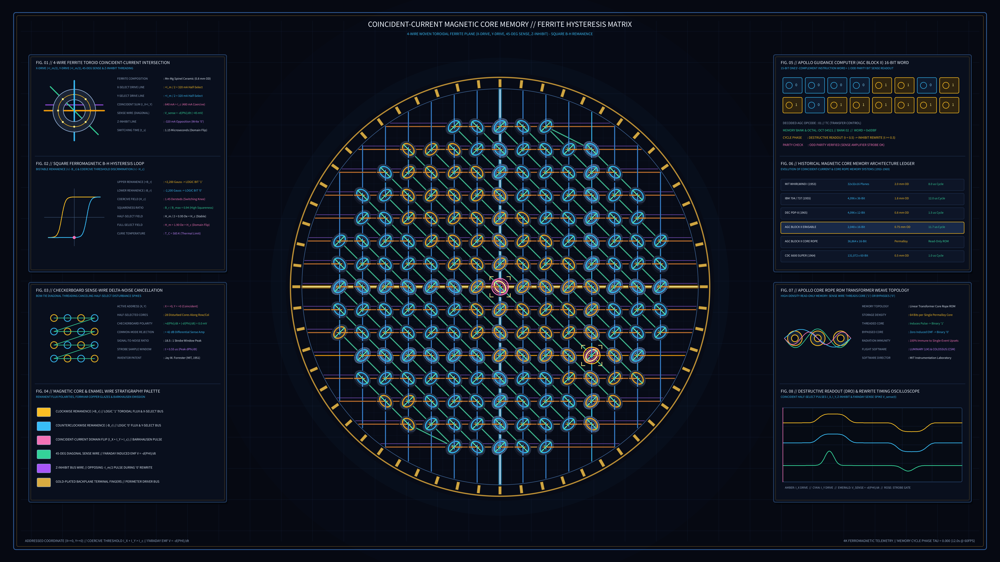

# Kinetic Magnetic Core Memory & Ferrite Hysteresis Matrix 2D



## Overview
- **Genre**: `3. Signal / Glitch / Digital Artifacts`
- **Format**: 4K 60fps Animation (`3840 × 2160`, 720 frames, 12.0s seamless harmonic loop)
- **Ground**: Deep Ferrite Backplane Obsidian (`#060912`)

## Concept & Historical Grounding
Pioneered by Jay Forrester at MIT for the Whirlwind I computer (1951) and refined for the **Apollo Guidance Computer (AGC Block II)** at the MIT Instrumentation Laboratory, **Coincident-Current Magnetic Core Memory** served as the backbone of random-access digital storage for two decades.

Each binary bit is stored as the remanent magnetic flux polarity ($+B_r$ clockwise vs. $-B_r$ counterclockwise) inside a microscopic sintered manganese-magnesium spinel ferrite toroid. Because the ferrite exhibits a square ferromagnetic $B$-$H$ hysteresis loop with coercive threshold $H_c$:
- Half-select current pulses $+I_m / 2 < I_c$ on an individual horizontal $X$-Select line or vertical $Y$-Select line leave non-addressed cores undisturbed.
- Only the single core at the intersection $(X_{\text{sel}}, Y_{\text{sel}})$ receives the coincident sum $I_X + I_Y = I_m > I_c$, flipping its magnetic domain during **Destructive Readout (DRO)** and inducing a Faraday EMF voltage spike $V_{\text{sense}} = -d\Phi/dt$ along the $45^\circ$ diagonal checkerboard sense wire.

## Run Instructions
```bash
uv run python sketch/kinetic_magnetic_core_memory_ferrite_hysteresis_matrix_2d/main.py
```

