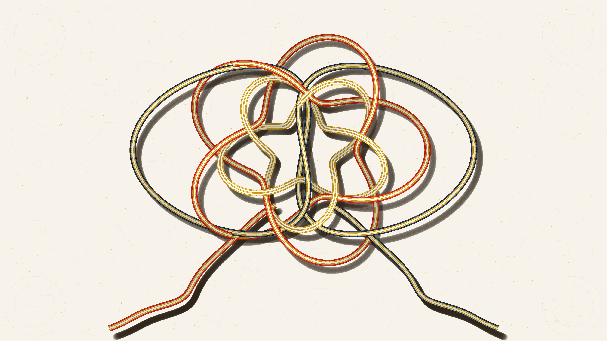

# kinetic_mizuhiki_ceremonial_knot_braiding_2d

Autonomous Generative py5 Media Art Animation (720 frames @ 60 FPS, 12.0s seamless loop, 4K Master).

## Concept

*Mizuhiki* (水引) is the ancient Japanese craft of stiffened washi paper cords wound with silk threads and burnished foil, traditionally knotted for ceremonial celebrations, sacred offerings, and betrothal gifts (*yuino-hin*). Each knot topology embodies profound cultural symbolism: the *Awaji-musubi* (鮑結び / abalone knot) signifies unbreakable, eternal bonds because tension only pulls the loops tighter; the *Ume-musubi* (梅結び / plum blossom knot) heralds resilience, perseverance through winter, and auspicious new beginnings.

*kinetic_mizuhiki_ceremonial_knot_braiding_2d* translates this sacred craft into a kinetic procedural artwork. Multi-strand parallel silk ribbons traverse continuous 3D space curve knot trajectories across a tactile warm unbleached kozo washi paper ground. A central 5-petal Ume plum blossom knot breathes and undulates in rhythmic harmony with an interwoven inner gilded rosette and flanking Awaji Carrick bow wings, while two flowing silk streamers (*nagare*) cascade gracefully toward the lower margins. The work investigates the physical tension, over-under topological interlacing, analytical drop shadows, and cylindrical silk thread sheen of ceremonial cord braiding, completely free of human author signatures or personal seals.

## Anti-Clustering & Diversity Compliance

- **Genre**: *Textile / Calligraphy / Procedural Craft* (Rotates strictly away from *Physical / Micro-Kinetic*, *Architectural / Brutalism / Geometric*, and *Mathematical / Abstract Topology*).
- **Background Tone**: Tactile warm unbleached kozo washi paper ground (`#f7f3ea`), providing high-luminance contrast and organic warmth.
- **Rendering Primitives**: Multi-strand parallel Frenet-Serret ribbon splines, analytical depth-sorted polygonal segments, tactile drop shadow penumbrae, kozo mulberry fiber grain, and burnished gold leaf flecks (*sunago* 砂子). **Zero particle streams or point clouds.**
- **Strict Anonymity**: 100% autonomous algorithmic generative art. Strictly zero artist signatures, zero seals/hanko (落款・印章), zero monograms, zero initials, and zero personal marks.
- **Palette**: Classical ceremonial triad of Japanese lacquer pigments and noble metals:
  - Warm Unbleached Kozo Washi Ground (`#f7f3ea`)
  - Ceremonial Lacquer Vermilion (*beni-iro* `#be1c1c` / `#f03a3a`)
  - Burnished Metallic Gold Leaf (*kin-paku* `#c3911e` / `#ffe86e`)
  - Raw Silk Pearl White (*shiro* `#f5f5f8` / `#ffffff`)
  - Royal Fermented Indigo (*kachi-iro* `#14243c` / `#34507a`)

## Mathematical Formulation

1. **5-Petal Ume (Plum Blossom) Torus Knot Kinematics**:
   The primary ceremonial knot is parameterized as a $(2, 5)$ torus knot modulated by harmonic breathing and rotational oscillation over period $T = 720$:
   $$r_1(s, \tau) = [R_0 + \Delta R \sin(\tau)] + [P_0 + \Delta P \cos(\tau)] \cos(5s)$$
   $$\theta_1(s, \tau) = 2s + A_\theta \sin(\tau)$$
   $$x_1(s, \tau) = X_c + r_1(s, \tau) \cos(\theta_1(s, \tau))$$
   $$y_1(s, \tau) = Y_c + 0.94 \cdot r_1(s, \tau) \sin(\theta_1(s, \tau))$$
   $$z_1(s, \tau) = H_1 \sin(5s)$$
   where $\tau = 2\pi t / T$, guaranteeing an exact seamless loop with strict $C^\infty$ continuity.

2. **Interwoven Gilded Blossom Counter-Topology**:
   An inner golden blossom is phase-shifted by $\pi/5$ in azimuth and counter-woven in elevation ($z_2 = -H_1 \sin(5s)$), creating authentic reciprocal over-under crossings.

3. **Multi-Strand Parallel Transport (Frenet-Serret Normal Offsets)**:
   For each strand $k \in \{-2, -1, 0, 1, 2\}$, the lateral position is offset perpendicular to the 2D curve tangent $\mathbf{T}(s) = (\dot{x}, \dot{y}) / \|\dot{\mathbf{r}}\|$ along normal $\mathbf{N}(s) = (-T_y, T_x)$:
   $$\mathbf{P}_k(s) = \mathbf{r}(s) + k \cdot w_{\text{strand}} \cdot \mathbf{N}(s)$$
   Each strand receives dual-pass cylindrical rendering (base tone + center specular sheen) modulated by depth ambient occlusion.

4. **Tactile Ground Shadow Projection**:
   Every curve segment casts a broad, warm umber drop shadow onto the washi ground plane with elevation-dependent offset and dispersion:
   $$\Delta x_{\text{sh}} = 26 + 18 \cdot \hat{z}, \quad \Delta y_{\text{sh}} = 34 + 22 \cdot \hat{z}$$
   where $\hat{z} \in [0, 1]$ is the normalized segment elevation.

## Specifications

- **Resolution**: $3840 \times 2160$ (4K UHD Master)
- **Duration**: 720 frames (12.0 seconds @ 60 FPS)
- **Audio / Loop**: Mathematically seamless periodic loop ($T = 720$)
- **Encoding**: H.264 / YUV420p / CRF 17 / Preset Slow
