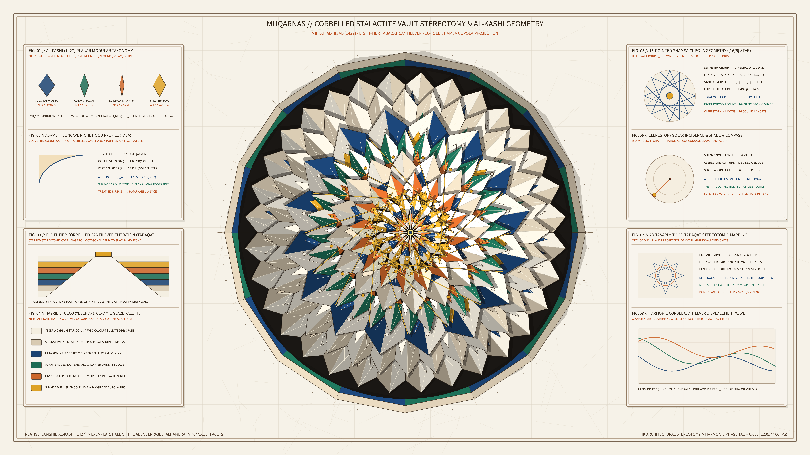

# kinetic_muqarnas_corbelled_stalactite_vault_stereotomy_2d



## Concept & Theme

**Al-Kashi's 1427 *Miftah al-Hisab* & Medieval Islamic Muqarnas (مقرنص) Corbelled Stalactite Vault Stereotomy**

In 1427, the Persian mathematician and astronomer Ghiyath al-Din Jamshid al-Kashi composed the *Miftah al-Hisab* ("The Key of Arithmetic"), presenting the first rigorous geometric treatise on the 3D stereotomy and modular construction of *Muqarnas*—the corbelled honeycomb and stalactite vaults that crown masterpieces of Islamic architecture such as the Hall of the Abencerrajes in the Alhambra (Granada) and the Shah Mosque (Isfahan).

A Muqarnas dome projects a 2D planar radial tessellation (*Tasarim*) of squares, rhombuses, almonds (*badam*), barleycorns (*sha'ira*), and bipeds (*shabaka*) upward into stepped 3D corbelled tiers (*tabaqat*). Each tier cantilevers inward over the tier below via concave niche hoods (*tasa*) and hanging stalactite pendants, culminating in a sunlit 16-pointed star cupola (*shamsa*).

This 4K 60fps simulation visualizes:

1. **8-Tier Corbelled Muqarnas Dome**: 176 concave vaulted niche cells (704 stereotomic facets) stepping inward from a 16-sided structural masonry drum to a central gilded 16-pointed *shamsa* rosette on warm Andalusian limestone drafting vellum (`#f6f2e8`).
2. **Harmonic Stereotomic Breathing & Clerestory Sunlight**: The 8 corbelled tiers breathe in harmonic cantilever resonance with 3D upward parallax while an oblique Mediterranean sunbeam sweeps across the carved gypsum stucco (*yesería*) and glazed ceramic facets, casting layered overhang shadows onto the tiers below.
3. **Eight Al-Kashi Stereotomic Apparatuses**: Four full-flank architectural blueprint panels detailing Al-Kashi's modular planar elements (*miqyas*), the concave niche profile curve (*tasa*), the 8-tier stepped corbel elevation section, Nasrid stucco and ceramic glazes, `{16/6}` *shamsa* cupola geometry, clerestory solar incidence compass, 2D-to-3D *Tasarim* lifting projection, and harmonic cantilever displacement waveforms.

Completely free of human author signatures, seals (*hanko*), or watermarks.

## Palette

- **Andalusian Limestone Drafting Vellum**: `#f6f2e8`
- **Carved Gypsum Stucco Ivory (Yesería)**: `#f4eee0`
- **Sierra Elvira Limestone Travertine**: `#d8ccb6`
- **Nasrid Lapis Cobalt Glaze**: `#1c4472`
- **Alhambra Celadon Emerald Glaze**: `#1e6c54`
- **Granada Terracotta Ochre**: `#ca6a2e`
- **Burnished Shamsa Gold Leaf**: `#da9c26`

## Run

```bash
uv run python sketch/kinetic_muqarnas_corbelled_stalactite_vault_stereotomy_2d/main.py
```

