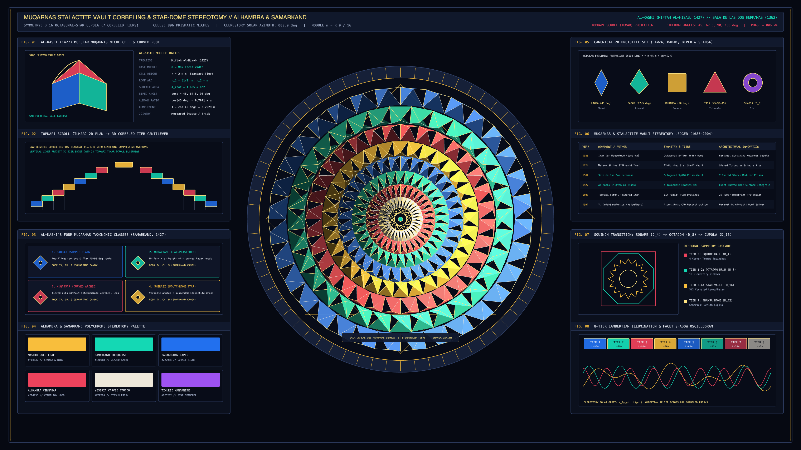

# kinetic_muqarnas_stalactite_vault_corbeling_stereotomy_2d

> **"Muqarnas Stalactite Vault Corbeling & Star-Dome Stereotomy"** — A 4K 60fps architectural stereotomy and recursive geometric vaulting animation of an 8-tier octagonal-star **Muqarnas (*Mocárabes*)** cupola inspired by Ghiyāth al-Dīn Jamshīd al-Kāshī's *Miftāḥ al-Ḥisāb* (Samarkand, 1427), the *Sala de las Dos Hermanas* dome at the Alhambra in Granada (1362), and the Timurid Topkapı Scroll (*Tūmār*, c. 1500).



## Concept & Architectural Stereotomy

A **Muqarnas** (*Mocárabes*) stalactite vault transitions a square hall ($D_4$) through an octagonal squinch drum ($D_8$) and 16/32-fold star tiers ($D_{16}, D_{32}$) up to a central **Shamsa** solar lantern without wooden centering formwork. As codified by **Ghiyāth al-Dīn al-Kāshī** in Book IV, Chapter 9 of *Miftāḥ al-Ḥisāb* (*The Key to Arithmetic*, 1427), every horizontal corbeled tier (*Ṭabaqa*) is projected upward from a 2D planar radial blueprint (**Ṭūmār**) tiled by five modular Euclidean prototiles scaled by the base module $m$:

1. **Lawza ($45^\circ$ Rhomb)** and **Bādam ($67.5^\circ$ Almond Deltoid)** vault hoods,
2. **Murabba ($90^\circ$ Square)** and **Tāsa ($45^\circ\text{–}90^\circ\text{–}45^\circ$ Intermediate Triangle)** pendentives,
3. **Sāq (Vertical Facet Legs)** and **Saqf (Curved Concave Niche Roofs)** that step inward layer by layer in self-supporting compressive equilibrium.

## Technical Implementation

- **896-Prism 3D Lambertian-Shaded Muqarnas Cupola (`NumPy` + `py5`)**: Across 8 concentric corbeled tiers inside a carved epigraphic drum bezel, 32-fold alternating star-polygon niches (`Lawza`, `Bādam`, and `Tāsa` facets) are grouped into luminance bins and rendered via `py5.QUADS` / `py5.vertices` and crisp gold/stucco groin ribs (`py5.lines`) as a clerestory solar beam $\vec{L}(\phi) = (\cos\phi, \sin\phi, 0.58)$ orbits $360^\circ$ over the 720-frame loop.
- **Eight Architectural & Stereotomic Telemetry Apparatuses (`FIG. 01`–`FIG. 08`)**: Includes al-Kāshī's modular niche cell & curved roof profile, the Topkapı Scroll 2D-to-3D corbel cantilever section, al-Kāshī's four taxonomic classes (*Sādhaj, Muṭayyan, Muqassar, Shīrāzī*), Alhambra/Samarkand polychrome palette, the 5 Euclidean prototiles, 1085–1992 historical ledger, $D_4 \to D_8 \to D_{16} \to D_{32}$ squinch cascade, and 8-tier Lambertian reflectance oscillogram.

## Run

```bash
uv run python sketch/kinetic_muqarnas_stalactite_vault_corbeling_stereotomy_2d/main.py
```

