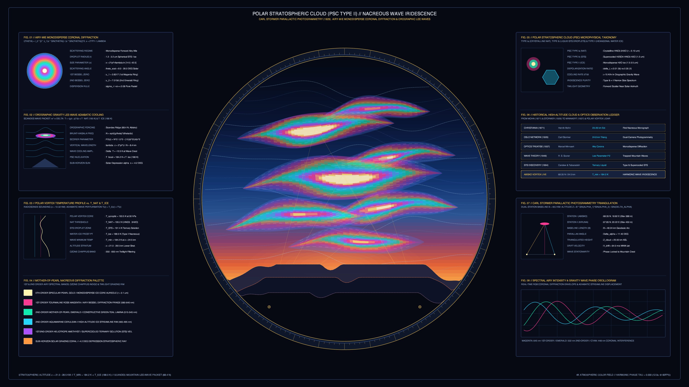

# kinetic_nacreous_polar_stratospheric_cloud_iridescence_2d

## Overview

- **Date**: 2026-11-05
- **Genre**: Atmospheric / Painterly / Color Field
- **Format**: 4K 60fps Seamless Loop Animation (3840×2160, 720 frames / 12.0s)
- **Background**: Dark — Deep Polar Vortex & Mesopause Obsidian (`#060912`)

## Concept & Atmospheric Physics

Inspired by **Carl Størmer's** 1929–1932 dual-station parallactic photogrammetry of Mother-of-Pearl clouds (*Perlemorskyer*) at $21\text{–}28.5\text{ km}$ altitude in the winter Arctic polar vortex, **Marcel Minnaert's** *Light and Color in the Outdoors* (1937), **R. S. Scorer's** 1949 theory of trapped mountain lee waves, and **Gustav Mie & George Biddell Airy's** monodisperse coronal diffraction theory:

1. **Orographic Internal Gravity Lee Waves & Adiabatic Stratospheric Cooling**:
   - Strong westerly flows crossing the Scandinavian Scandes mountain range ($68.4^\circ\text{ N}$, Abisko–Kiruna) excite vertically propagating internal gravity waves governed by the Scorer parameter $l^2(z) = \frac{N^2}{U^2} - \frac{1}{U}\frac{d^2 U}{dz^2}$.
   - At altitudes of $21\text{–}28.5\text{ km}$, adiabatic expansion in the wave crests cools the synoptic polar vortex ($T_0 \approx 193.5\text{ K}$) by $\Delta T \approx -12.5\text{ K}$, plunging local temperatures below the nitric acid trihydrate threshold ($T_{\text{NAT}} = 195.2\text{ K}$), the supercooled ternary solution zone ($T_{\text{STS}} = 191.4\text{ K}$), and the water-ice frost point ($T_{\text{ice}} = 188.0\text{ K}$).

2. **Airy-Mie Monodisperse Coronal Diffraction (Mother-of-Pearl Iridescence)**:
   - Rapid cooling nucleates monodisperse spherical STS droplets and hexagonal water-ice crystals ($r \approx 1.2\text{–}3.2\text{ }\mu\text{m}$, size dispersion $\sigma_r / \langle r \rangle < 0.08$) arranged in laminar streamline contours along the lenticular wave foil.
   - Forward-scattered sub-horizon twilight ($\alpha_{\text{sun}} = -4.2^\circ$) produces constructive first- and second-order Airy-Bessel diffraction fringes:
     $$I(\theta, \lambda) \propto I_0(\lambda) \left[\frac{2 J_1(x \sin\theta)}{x \sin\theta}\right]^2, \quad x = \frac{2\pi r}{\lambda}$$
   - As particle radius $r(U, V)$ varies smoothly from the outer evaporation veil to the inner frost core, the cloud decks shimmer across two full spectral orders of tourmaline rose-magenta, heliotrope violet, peacock emerald, aquamarine cyan, and opalescent pearl-gold.

