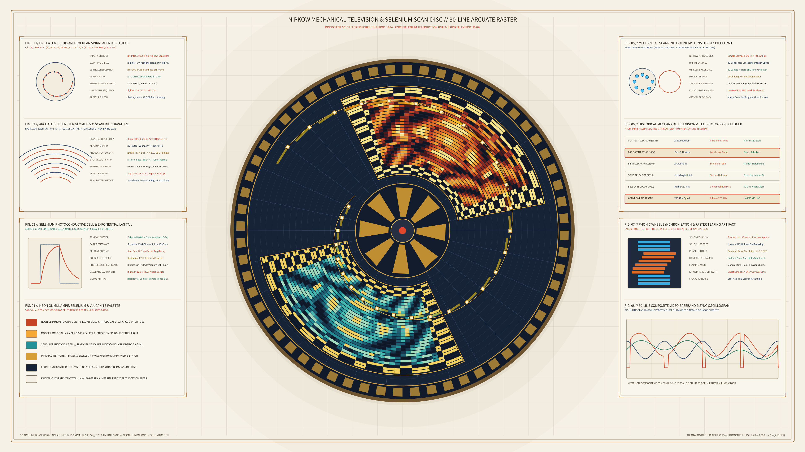

# kinetic_nipkow_mechanical_television_selenium_scan_disc_2d

## Overview

- **Date**: 2026-11-05
- **Genre**: Signal / Glitch / Digital Artifacts
- **Format**: 4K 60fps Seamless Loop Animation (3840×2160, 720 frames / 12.0s)
- **Background**: Light — Warm Imperial Patent & Phototelegraphy Vellum (`#f5f1e6`)

## Concept & Mathematical Foundation

Inspired by **Paul Gottlieb Nipkow's** Christmas Eve 1883 invention of the *Elektrisches Teleskop* (Imperial German Patent **DRP 30105**, filed January 6, 1884), **Arthur Korn's** 1904 *Bildtelegraphie* compensated selenium photoconductive bridge, and **John Logie Baird's** January 26, 1926 30-line mechanical *Televisor* demonstration in Soho, London:

1. **Archimedean Spiral Aperture Locus ($N = 30$ Scanlines)**:
   - Thirty square/diamond brass-mounted apertures are punched along a single-turn Archimedean spiral on a vulcanized ebonite rotor disc:
     $$r_k = R_{\text{outer}} - k \cdot \frac{H_{\text{gate}}}{N}, \quad \theta_k = \theta_{\text{disc}}(t) + \frac{2\pi k}{N}, \quad k \in \{0, 1, \dots, 29\}$$
   - Because each aperture sweeps at a constant radius $r_k$ across the sectorial viewing window (*Bildfenster*), the resulting raster is not rectangular but an **arcuate wedge** with radial sagitta $s_k = r_k(1 - \cos(\Delta\Phi/2))$ and keystone peripheral velocity gradient $v_k = \omega_{\text{disc}} r_k$.

2. **Dual Conjugate Gates — Neon *Glimmlampe* Receiver & Selenium Photocell Transmitter**:
   - **Upper-Right Gate (Neon *Glimmlampe* Receiver)**: Cold-cathode neon-helium gas discharge glow (`640.2 nm` crimson-vermilion `#ca3622` to `585.2 nm` Moore-lamp sodium-amber `#ea8e24` and `#f8d864` highlights) reconstructing a 30-line arcuate television test pattern and geometric portrait phantom.
   - **Lower-Left Gate (Selenium Photoconductive Transmitter)**: Trigonal metallic selenium bridge (`#1a8882` to `#66e6d8` cyan-teal) scanning the conjugate flying-spot illumination field.

3. **Selenium Exponential Persistence Lag & LaCour Phonic Wheel Synchronization Tear**:
   - Trigonal selenium's carrier trap relaxation time ($\tau_{\text{Se}} \approx 12\text{ ms}$) creates asymmetric horizontal comet-tail persistence smearing along the scan direction:
     $$S_k(\phi) = \int_0^{\Delta\phi} I_k(\phi - u)\, e^{-u / \tau_{\text{Se}}}\,du$$
   - Periodic electromagnetic phase hunting in **Paul LaCour's** 30-tooth iron phonic synchronization wheel (*Phonisches Rad*, $f_{\text{sync}} = 375.0\text{ Hz}$) induces discrete horizontal scanline tearing displacements $\delta\phi_k(t)$ across the arcuate raster.

