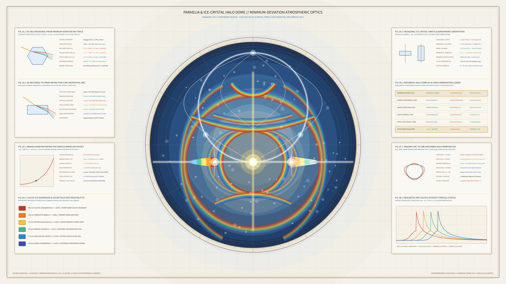

# Kinetic Parhelia & Ice-Crystal Halo Refraction Dome 2D



## Overview
- **Genre**: `4. Atmospheric / Painterly / Color Field`
- **Format**: 4K 60fps Animation (`3840 × 2160`, 720 frames, 12.0s seamless harmonic loop)
- **Ground**: Sunlit Polar Cirrostratus & Archival Meteorological Vellum (`#f4f1ea`)

## Concept & Optical Grounding
Inspired by the 1535 Stockholm *Vädersolstavlan* (*The Sundog Painting*), René Descartes's *Les Météores* (1637), Tobias Lowitz's 1790 St. Petersburg Halo Complex, Auguste Bravais's *Mémoire sur les halos* (1847), and Walter Tape's *Atmospheric Halos* (1994), this work simulates an all-sky polar cirrostratus ice-crystal halo display.

Because hexagonal ice crystals ($I_h$) exhibit wavelength-dependent Cauchy dispersion ($n_{\text{red}} = 1.3078$ at $656\text{ nm}$ to $n_{\text{violet}} = 1.3170$ at $410\text{ nm}$) and inverse-square-root minimum-deviation caustic singularities ($D_{\min} = 21.84^\circ$ for $60^\circ$ alternate prism faces and $45.74^\circ$ for $90^\circ$ basal-to-prism faces), the sky dome blooms into layered, painterly spectral color-field ribbons:
1. **$22^\circ$ & $46^\circ$ Circular Halos** with Babinet's darkened inner sky zone ($D < 21.84^\circ$).
2. **Left & Right Parhelia (Sundogs)** shifting outward from the $22^\circ$ halo as solar elevation $e_\odot$ oscillates via Bravais's skew-ray refractive index $n'(e) = \sqrt{(n^2 - \sin^2 e)/\cos^2 e}$.
3. **Upper & Lower Tangent Arcs**, **Singly-Curved Parry Arc**, **Circumzenithal Arc**, **Supralateral/Infralateral Arcs**, **Lowitz Arcs**, **$360^\circ$ White Parhelic Circle**, and **Anthelic Wegener Arcs**.

## Run Instructions
```bash
uv run python sketch/kinetic_parhelia_ice_crystal_halo_refraction_dome_2d/main.py
```

