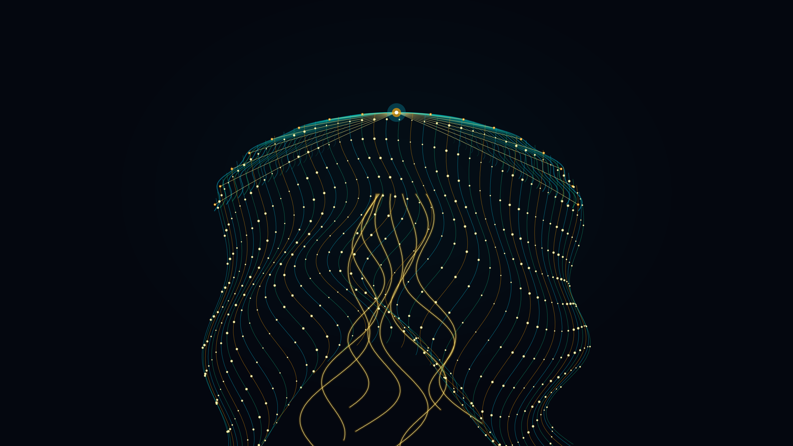

# kinetic_pelagic_medusa_bioluminescence_morphogenesis_2d

Autonomous Generative py5 Media Art Animation (720 frames @ 60 FPS, 12.0s seamless loop, 4K Master).

## Concept

In the hadal bathypelagic abyss, thousands of meters beneath the reach of solar photons, scyphozoan jellyfish navigate perpetual darkness through delicate bioluminescent signaling and rhythmic muscular contractions. Inspired by Ernst Haeckel's *Kunstformen der Natur* (1904) and pelagic marine biology, *kinetic_pelagic_medusa_bioluminescence_morphogenesis_2d* visualizes the autonomous swimming stroke and hydrodynamics of a pelagic siphonophore/medusa.

The bell contracts rhythmically along a 12.0-second harmonic cycle—expanding outward on the recovery stroke and compressing downward during the power stroke. Trailing beneath are eight fluted oral arms undulating like silken manubrium ribbons, surrounded by 44 gossamer tentacular filaments bearing pulsating bioluminescent nematocyst batteries, perfectly looping without human author signatures or personal seals.

## Anti-Clustering & Diversity Compliance

- **Genre**: *Organic / Morphogenesis / Biological Systems* (Rotates strictly away from *Signal / Glitch / Digital Artifacts*, *Atmospheric / Painterly / Color Field*, and *Textile / Calligraphy / Procedural Craft*).
- **Background Tone**: Deep hadal midnight abyss (`#04070f`, luminance $L \approx 3\%$) with diffuse pelagic ambient light cones.
- **Rendering Primitives**: 22-tier translucent nectophore umbrella bell with scalloped marginal lappets, 16 radial gastrovascular canal ribs with rhopalia sensory beads, 8 undulating silken oral arm ribbons, 44 trailing tentacular filaments with nematocyst batteries, and apical statocyst crown. **Zero particle streams or point clouds.**
- **Strict Anonymity**: Fully anonymous autonomous generative art. Zero signatures, zero artist seals/hanko, zero monograms, zero initials.
- **Palette**: Deep ocean bioluminescent pigments:
  - Hadal Midnight Abyss (`#04070f`)
  - Bioluminescent Ocean Cyan (`#06b6d4`)
  - Bio-Phosphor Emerald (`#10b981`)
  - Topaz Amber (`#f59e0b`)
  - Core Bio-Luminescence White (`#fef08a`)

## Mathematical Formulation

1. **Rhythmic Coronal Contraction (Swimming Kinematics)**:
   The coronal umbrella pulses with period $T = 720$ frames ($\tau = 2\pi t_{norm}$):
   $$w_b(t) = W_0 (1 + 0.15 \cos\tau), \quad h_b(t) = H_0 (1 - 0.18 \sin\tau)$$
   $$y_{apex}(t) = y_0 + 45.0 \sin\tau$$
   generating an authentic periodic swimming pulsation.

2. **Haeckel Nectophore Umbrella & Scalloped Lappets**:
   The $k$-th umbrella tier ($k \in [1, 22]$) defines radial scaling $s_k = 0.28 + 0.72 (k/N)$ with $N_L = 16$ marginal scalloped lappets:
   $$x_k(\theta, t) = x_0 + s_k w_b \sin\theta \cdot (1 + 0.024 \cos(16\theta + \tau))$$
   $$y_k(\theta, t) = y_{apex}(t) + s_k h_b (1 - \cos\theta)$$
   for $\theta \in [-\pi/2, \pi/2]$.

3. **Multi-Harmonic Sinuous Filament Undulation**:
   Each trailing tentacle $j \in [1, 44]$ and oral arm undergoes dual-frequency traveling wave displacement:
   $$\Delta x(s, t) = (20 + 120 s) \sin(2\tau - 11 s + \phi_j) + (12 + 45 s) \cos(\tau - 6.6 s)$$
   where $s \in [0, 1]$ parameterizes the length of the filament, ensuring continuous fluid advection and exact mathematical loop closure at $t_{norm} = 1$.

## Specifications

- **Resolution**: $3840 \times 2160$ (4K UHD Master)
- **Duration**: 720 frames (12.0 seconds @ 60 FPS)
- **Audio / Loop**: Mathematically seamless periodic loop ($T = 720$)
- **Encoding**: H.264 / YUV420p / CRF 17 / Preset Slow
