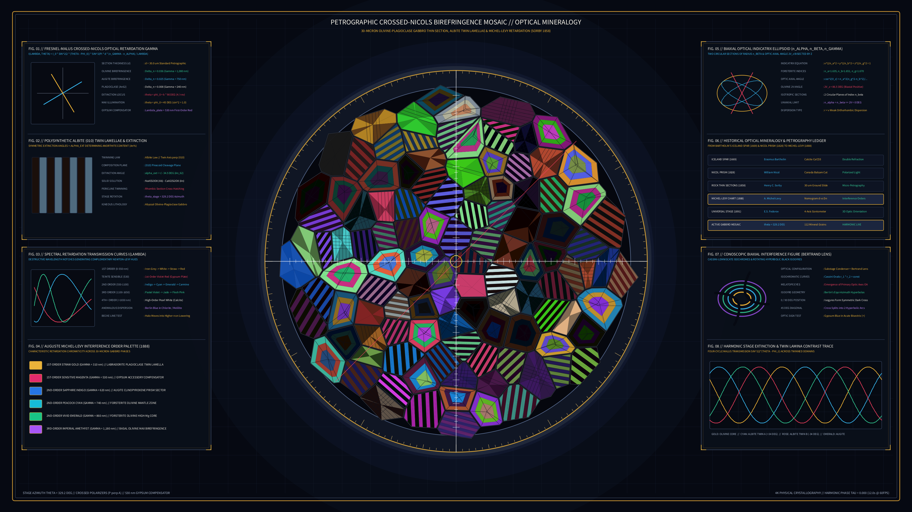

# Kinetic Petrographic Crossed-Nicols Birefringence Mosaic 2D

## Concept & Theme
Autonomous generative media art in the **Physical / Micro-Kinetic** genre exploring polarized optical mineralogy, thin-section petrography, and anisotropic crystal birefringence (William Nicol's 1828 calcite polarizing prism; Henry Clifton Sorby's 1858 $30\text{ }\mu\text{m}$ rock thin-section microscopy; Auguste Michel-Lévy's 1888 birefringence interference color chart), executed on deep optical bench & extinction obsidian (`#060912`).

A $30\text{ }\mu\text{m}$ thin section of abyssal olivine-plagioclase-clinopyroxene gabbro (troctolite) rotates on a graduated $360^\circ$ petrographic goniometer stage between a lower polarizer ($P$: $0^\circ\text{ N-S}$) and an orthogonal upper analyzer ($A$: $90^\circ\text{ E-W}$) with a diagonal $530\text{ nm}$ First-Order Red (gypsum $\lambda$-plate) compensator. Over 110 interlocking polycrystalline mineral grains—chemically zoned Forsterite Olivine ($\Delta n = 0.036$), polysynthetically twinned Labradorite Plagioclase ($\Delta n = 0.008$, Albite `(010)` twin lamellae), and cleaved Augite Clinopyroxene ($\Delta n = 0.025$)—modulate their transmitted interference spectra via the Fresnel-Malus retardation law $I(\lambda, \theta) = I_0 \sin^2(2(\theta - \phi_0)) \sin^2(\pi d \Delta n / \lambda)$, flanked by eight optical crystallography apparatuses, completely free of author signatures, seals, or watermarks.

## Algorithmic & Mathematical Highlights
- **Sutherland-Hodgman Clipped Voronoi Polycrystalline Tessellation**: 112 mineral grains with intergranular Becke-line rims are subdivided into phase-specific microstructures: 3-zone concentric chemical zoning + irregular fracture veins for Olivine, 6–11 parallel clipped Albite `(010)` twin strips for Plagioclase, and $87^\circ/93^\circ$ orthogonal prismatic cleavage grids for Clinopyroxene.
- **Fresnel-Malus Crossed-Nicols Retardation Synthesis**: Real-time wavelength-dependent interference evaluation across RGB bands with $\pm 530\text{ nm}$ sensitive-tint gypsum compensation and four-fold optical extinction ($\sin^2 2(\theta - \phi_0)$), quantized and batch-rendered via `py5.QUADS` / `py5.vertices`.
- **Eight Scholarly Telemetry Apparatuses**:
  1. `FIG. 01`: Fresnel-Malus crossed-Nicols optical retardation $\Gamma = d(n_\gamma - n_\alpha)$ & rotating vibration vectors.
  2. `FIG. 02`: Polysynthetic Albite `(010)` twin lamellae & symmetric Michel-Lévy extinction angles $\pm \alpha_{\text{ext}}$.
  3. `FIG. 03`: Spectral retardation transmission curves $I(\lambda) = \sin^2(\pi \Gamma / \lambda)$ across visible wavelengths.
  4. `FIG. 04`: Auguste Michel-Lévy (1888) 1st-, 2nd-, and 3rd-order interference color palette.
  5. `FIG. 05`: Biaxial optical indicatrix ellipsoid $(n_\alpha, n_\beta, n_\gamma)$, circular sections, and $2V_z$ optic axial angle.
  6. `FIG. 06`: Historical optical mineralogy & petrography ledger (Bartholin 1669, Nicol 1828, Sorby 1858, Michel-Lévy 1888, Fedorov 1891).
  7. `FIG. 07`: Conoscopic Bertrand-lens biaxial interference figure (Cassini-lemniscate isochromes & rotating hyperbolic black isogyres).
  8. `FIG. 08`: Harmonic stage extinction $\sin^2 2(\theta - \phi_i)$ and twin-lamina contrast oscillogram.

