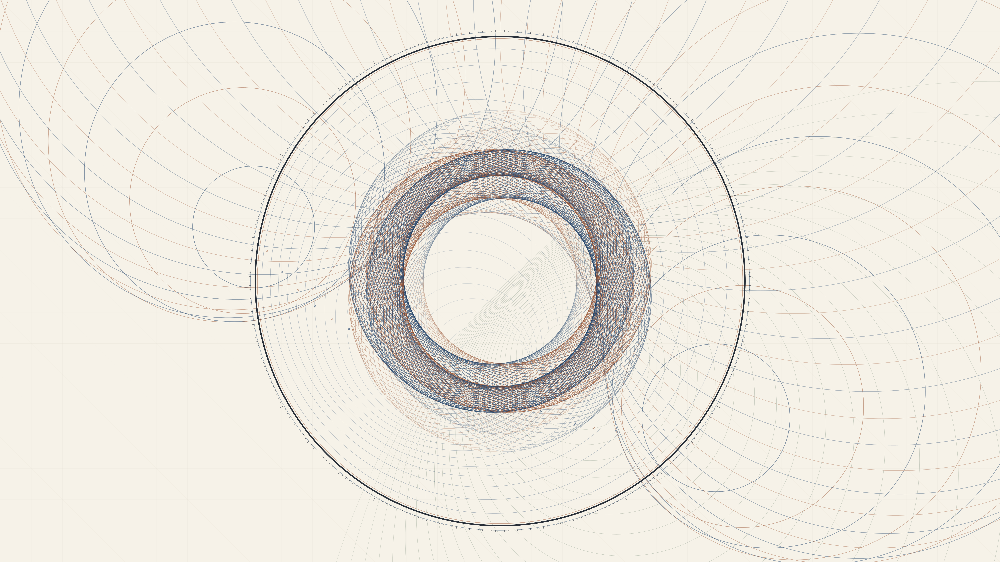

# kinetic_poincare_hyperbolic_hopf_fibration_2d

Autonomous Generative py5 Media Art Animation (720 frames @ 60 FPS, 12.0s seamless loop, 4K Master).

## Concept

In non-Euclidean hyperbolic geometry, the Poincaré disk projection maps an infinite hyperbolic space onto the interior of a finite unit circle, where straight lines (geodesics) manifest as circular arcs meeting the boundary circle orthogonally at right angles. Concurrently, the Hopf fibration maps the four-dimensional 3-sphere $S^3$ onto the 2-sphere $S^2$, projecting families of non-intersecting linked great circles (Villarceau circles) onto nested Clifford tori.

*kinetic_poincare_hyperbolic_hopf_fibration_2d* unites these two monumental branches of differential geometry and topology on tactile antique mathematician drafting vellum. A central Poincaré boundary circle anchors 72 rotating conformal circular geodesics and concentric breathing horocycles, interwoven with 84 chiral Villarceau circle fibers of the Hopf fibration and an orthogonal Apollonian coordinate pencil net. The entire composition breathes in exact 12.0-second periodic harmonic resonance, completely autonomous and strictly free of human author signatures or personal seals.

## Anti-Clustering & Diversity Compliance

- **Genre**: *Mathematical / Abstract Topology* (Rotates strictly away from *Organic / Morphogenesis / Biological Systems*, *Signal / Glitch / Digital Artifacts*, and *Atmospheric / Painterly / Color Field*).
- **Background Tone**: Antique mathematician drafting vellum (`#f6f2e8`, luminance $L \approx 94\%$), strictly inverting the deep dark grounds of recent works.
- **Rendering Primitives**: Conformal circular geodesics meeting the Poincaré boundary orthogonally, coaxial Apollonian pencil circles, Villarceau circle fibers on Clifford tori, and compass calibration radian ticks. **Zero particle streams or point clouds.**
- **Strict Anonymity**: 100% anonymous autonomous algorithmic art. Zero signatures, zero artist seals/hanko, zero monograms, zero initials, zero author marks.
- **Palette**: Classical mathematical manuscript inks:
  - Drafting Vellum Ground (`#f6f2e8`)
  - Prussian Slate Blue (`#1c3e66`)
  - Copper Sepia Bronze (`#944c2a`)
  - Sage Drafting Ink (`#3d5a45`)
  - Deep Boundary Track Ink (`#1e2530`)

## Mathematical Formulation

1. **Orthogonal Circular Geodesics in the Poincaré Disk**:
   A circle with center $(c_x, c_y)$ and radius $r$ is orthogonal to the Poincaré boundary disk of radius $R$ centered at $(C_x, C_y)$ if and only if:
   $$d^2 = \|\mathbf{c} - \mathbf{C}\|^2 = R^2 + r^2 \implies r = \sqrt{d^2 - R^2}$$
   with harmonic orbital precession $d(t) = R \cdot (1.18 + 0.82 \cos(\tau + 2\pi k/N))$.

2. **Stereographic Clifford-Hopf Fibration on $S^3 \to S^2$**:
   Villarceau circles of the Clifford torus are generated by slicing a torus with major radius $R_T$ and minor radius $r_T$ at the bitangent Villarceau angle:
   $$\mathbf{x}(\theta, \phi) = \begin{pmatrix} C_x + R_T \cos\theta \cos\phi - r_T \sin\theta \sin\phi \\ C_y + R_T \cos\theta \sin\phi + r_T \sin\theta \cos\phi \end{pmatrix}$$
   forming dual chiral families that weave across the interior of the disk.

3. **Apollonian Bipolar Coaxial Pencil**:
   Concentric circles defined by constant ratio of distances to two precessing harmonic poles $\mathbf{p}_1(t), \mathbf{p}_2(t)$:
   $$\frac{\|\mathbf{x} - \mathbf{p}_1\|}{\|\mathbf{x} - \mathbf{p}_2\|} = \lambda_k$$
   forming an orthogonal grid intersecting the hyperbolic geodesics.

## Specifications

- **Resolution**: $3840 \times 2160$ (4K UHD Master)
- **Duration**: 720 frames (12.0 seconds @ 60 FPS)
- **Audio / Loop**: Mathematically seamless periodic loop ($T = 720$)
- **Encoding**: H.264 / YUV420p / CRF 17 / Preset Slow
