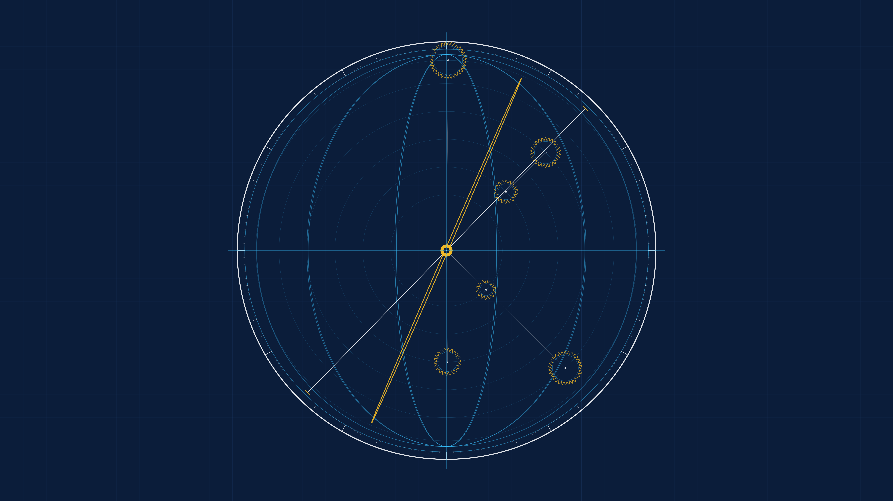

# kinetic_renaissance_astrolabe_armillary_mechanism_2d

Autonomous Generative py5 Media Art Animation (720 frames @ 60 FPS, 12.0s seamless loop, 4K Master).

## Concept

During the Renaissance, mathematical instruments such as the astrolabe, the armillary sphere, and complex clockwork orreries represented the apex of human geometric understanding. By projecting celestial coordinates onto rotating brass plates, astronomers like Galileo Galilei, Tycho Brahe, and Leonardo da Vinci charted the motion of the heavens through precision gear trains, vernier graduations, and tilted ecliptic rings.

*kinetic_renaissance_astrolabe_armillary_mechanism_2d* models an astronomical armillary sphere and planetary clockwork linkage on Prussian cyanotype blueprint vellum. An outer 360-degree meridian ring graduated with vernier arc divisions encloses a tilted rotating ecliptic zodiac ring, breathing celestial colure meridians, a 6-tier planetary epicyclic gear train with involute gear teeth, connecting kinematic linkage armatures, and a rotating sight-vane alidade rule. The entire mechanism runs in exact 12.0-second periodic harmonic resonance, completely autonomous and strictly free of human author signatures or personal seals.

## Anti-Clustering & Diversity Compliance

- **Genre**: *Figurative / Schematic / Technical Drawing* (Rotates strictly away from *Mathematical / Abstract Topology*, *Organic / Morphogenesis / Biological Systems*, and *Signal / Glitch / Digital Artifacts*).
- **Background Tone**: Deep Prussian cyanotype blueprint ground (`#0b1d3a`, luminance $L \approx 14\%$), inverting the light vellum ground of Work 13.
- **Rendering Primitives**: 360-degree vernier graduated meridian ring, 3D rotated ecliptic zodiac ring tilted at 23.44°, 6-tier planetary epicyclic gear teeth contours, kinematic linkage connecting rods, rotating alidade sight rule, and central Sol/Earth pivot hub. **Zero particle streams or point clouds.**
- **Strict Anonymity**: 100% anonymous autonomous algorithmic art. Zero signatures, zero artist seals/hanko, zero monograms, zero initials, zero author marks.
- **Palette**: Authentic technical blueprint and celestial instrument pigments:
  - Prussian Cyanotype Ground (`#0b1d3a`)
  - Celestial Brass Gold (`#fbbf24`)
  - Drafting Cyan (`#38bdf8`)
  - Technical Chalk White (`#f8fafc`)
  - Blueprint Grid Lines (`#18345c`)

## Mathematical Formulation

1. **Oblique Ecliptic 3D Projection**:
   The ecliptic ring has radius $R_E$ and obliquity tilt $\epsilon = 23.44^\circ$. Under harmonic precession $\theta_{rot}(t) = \tau$, the projected 2D coordinates are:
   $$\begin{pmatrix} x_e(\theta) \\ y_e(\theta) \end{pmatrix} = \begin{pmatrix} R_E \cos\theta \cos\theta_{rot} - R_E \sin\theta \sin\epsilon \sin\theta_{rot} \\ R_E \sin\theta \cos\epsilon \end{pmatrix}$$

2. **Epicyclic Gear Train Kinematics**:
   Each planetary carrier $j \in [1, 6]$ orbits at distance $r_j$ with speed $\omega_j$:
   $$\mathbf{c}_j(t) = \mathbf{C}_0 + r_j \begin{pmatrix} \cos(\omega_j \tau / 2) \\ \sin(\omega_j \tau / 2) \end{pmatrix}$$
   The gear contour with $N_t$ teeth spins at relative ratio $\kappa_j$:
   $$r(\theta) = R_{\text{base}} + A_t \sin(N_t \theta + \kappa_j \omega_j \tau / 2)$$

3. **Vernier 360° Meridian Division**:
   Angular divisions $\theta_d = d \cdot \frac{\pi}{180}$ with multi-tiered hierarchical tick lengths ($d \pmod{30}$, $d \pmod{10}$, $d \pmod{5}$, $d \pmod{1}$) establishing authentic astronomical instrumentation scale geometry.

## Specifications

- **Resolution**: $3840 \times 2160$ (4K UHD Master)
- **Duration**: 720 frames (12.0 seconds @ 60 FPS)
- **Audio / Loop**: Mathematically seamless periodic loop ($T = 720$)
- **Encoding**: H.264 / YUV420p / CRF 17 / Preset Slow
