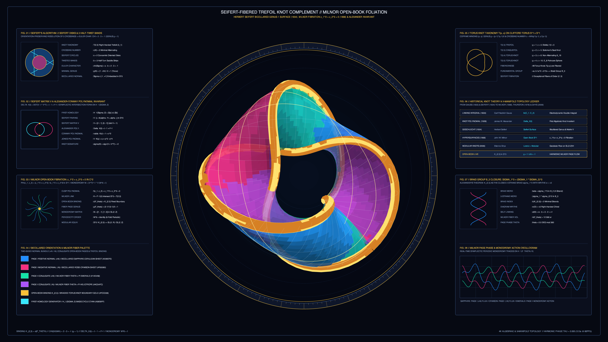

# kinetic_seifert_fibered_trefoil_knot_complement_foliation_2d

## Overview

- **Date**: 2026-11-05
- **Genre**: Mathematical / Abstract Topology
- **Format**: 4K 60fps Seamless Loop Animation (3840×2160, 720 frames / 12.0s)
- **Background**: Dark — Deep 3-Manifold & Chern-Simons Obsidian (`#060912`)

## Concept & Topological Foundation

Inspired by **Herbert Seifert's** *Über das Geschlecht von Knoten* (1934), **John W. Milnor's** *Singular Points of Complex Hypersurfaces* (1968), **Dale Rolfsen's** *Knots and Links* (1976), and **Étienne Ghys & Jos Leys's** modular flow and Lorenz knot visualizations:

1. **The $(2,3)$ Trefoil Knot $K_{2,3} \subset S^3$ & Seifert's Bicollared Surface ($\Sigma_K$)**:
   - The right-handed trefoil knot $K_{2,3}$ is the $(2,3)$ torus knot on $S^1 \times S^1 \subset S^3$ and the link of the complex cusp singularity $f(z_1, z_2) = z_1^2 + z_2^3 = 0$ intersected with $S^3 \subset \mathbb{C}^2$.
   - Applying **Seifert's Algorithm** to the minimal 3-crossing alternating diagram yields $s = 2$ oriented Seifert circles connected by $b = 3$ half-twisted saddle bands, producing an orientable bicollared surface $\Sigma_K$ with Euler characteristic $\chi(\Sigma_K) = s - b = 2 - 3 = -1$ and minimal genus $g(K_{2,3}) = \frac{1 - \chi}{2} = 1$.

2. **Milnor Open-Book Fibration $\phi: S^3 \setminus K_{2,3} \to S^1$ & Algebraic Invariants**:
   - By Milnor's Fibration Theorem, the map $\phi(z_1, z_2) = \frac{z_1^2 + z_2^3}{|z_1^2 + z_2^3|} \in S^1$ decomposes the knot complement $S^3 \setminus K_{2,3}$ into an open book of genus-$1$ Seifert surface pages $F_\theta = \phi^{-1}(e^{i\theta})$ sharing the fixed boundary $\partial F_\theta = K_{2,3}$.
   - In the first homology basis $H_1(\Sigma_K; \mathbb{Z}) \cong \mathbb{Z}[\alpha] \oplus \mathbb{Z}[\beta]$, the Seifert linking matrix $V_{ij} = \text{lk}(\alpha_i^+, \alpha_j)$ is:
     $$V = \begin{pmatrix} -1 & 1 \\ 0 & -1 \end{pmatrix}, \quad \Delta_K(t) = \det(V - t V^T) = t - 1 + t^{-1}$$
   - Sweeping the page angle $\theta$ by $2\pi$ induces the periodic symplectic monodromy $M = (V^T)^{-1} V = \begin{pmatrix} 1 & -1 \\ 1 & 0 \end{pmatrix} \in \text{SL}(2, \mathbb{Z})$ of order $6$ ($M^6 = I$).

