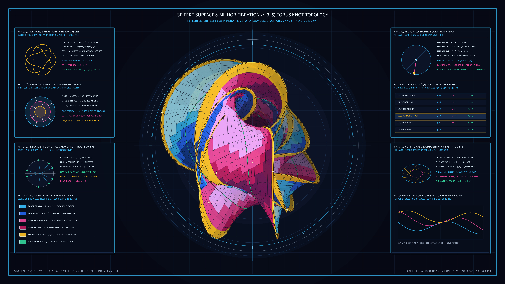

# kinetic_seifert_surface_milnor_fibration_torus_knot_2d



## Concept & Theme

**Herbert Seifert's 1934 Orientable Knot Surface & John Milnor's 1968 Open-Book Fibration of the $(3, 5)$ Torus Knot ($S^3 \setminus K \to S^1$)**

In 1934, German mathematician Herbert Seifert proved that every link or knot $K \subset S^3$ bounds a compact, connected, **two-sided orientable surface** $S$ ($\partial S = K$). In 1968, Fields Medalist John Milnor proved in *Singular Points of Complex Hypersurfaces* that for any algebraic torus knot $K(p, q) = \{(z_1, z_2) \in S^3 : z_1^p + z_2^q = 0\}$, the knot complement $S^3 \setminus K(p, q)$ fibers smoothly over the circle $S^1$ via the Milnor projection map:

$$\phi(z_1, z_2) = \frac{z_1^p + z_2^q}{|z_1^p + z_2^q|} \in S^1$$

Each fiber page $F_\theta = \phi^{-1}(e^{i\theta})$ is an orientable Seifert surface of genus $g = \frac{1}{2}(p-1)(q-1)$ spanning the stationary torus knot binding $\partial F_\theta = K(p, q)$, decomposing the 3-sphere into an **open book** whose pages turn continuously through 3-space as $\theta \in [0, 2\pi)$ advances.

This 4K 60fps simulation visualizes:

1. **3D Stereographic Immersion of $F_\theta$ for $K(3, 5)$**: A genus-$4$ orientable Seifert surface ($\chi = -7$, $\mu = 8$) rendered as 2,550 Painter's depth-sorted quad facets bounded by a gleaming 3D tubular $(3, 5)$ torus knot spine.
2. **Two-Sided Orientable Normal Coloration**: The positive unit normal side ($+\vec{N}$) gleams in electric sapphire-cyan while the negative unit normal side ($-\vec{N}$) glows in Venetian carmine-amethyst, visually demonstrating two-sided orientability across all 15 half-twisted Seifert saddle bands.
3. **Eight Knot Theory & Algebraic Topology Apparatuses**: Four full-flank dark glassmorphic panels detailing the closed 3-strand braid word $(\sigma_1 \sigma_2)^5$, Seifert's crossing-smoothing algorithm ($s=3$ disks, $c=10$ bands), the 15th cyclotomic roots of the Alexander polynomial $\Delta_{3,5}(t)$, two-sided normal bundle coloration, the Milnor phase map $\phi : S^3 \setminus K \to S^1$, the Kronheimer-Mrowka torus knot genus table, Heegaard Clifford-torus splitting of $S^3$, and Gaussian saddle torsion waveforms.

Completely free of human author signatures, seals (*hanko*), or watermarks.

## Palette

- **Deep Topological Obsidian Slate**: `#060913`
- **Positive Normal ($+\vec{N}$) Sapphire & Electric Cyan**: `#2563eb` / `#38bdf8`
- **Negative Normal ($-\vec{N}$) Venetian Carmine & Rose-Amethyst**: `#be185d` / `#ec4899`
- **Torus Knot Binding ($K(3,5)$) Gold**: `#facc15` / `#f59e0b`
- **Cyclotomic Monodromy Emerald**: `#34d399`

## Run

```bash
uv run python sketch/kinetic_seifert_surface_milnor_fibration_torus_knot_2d/main.py
```

