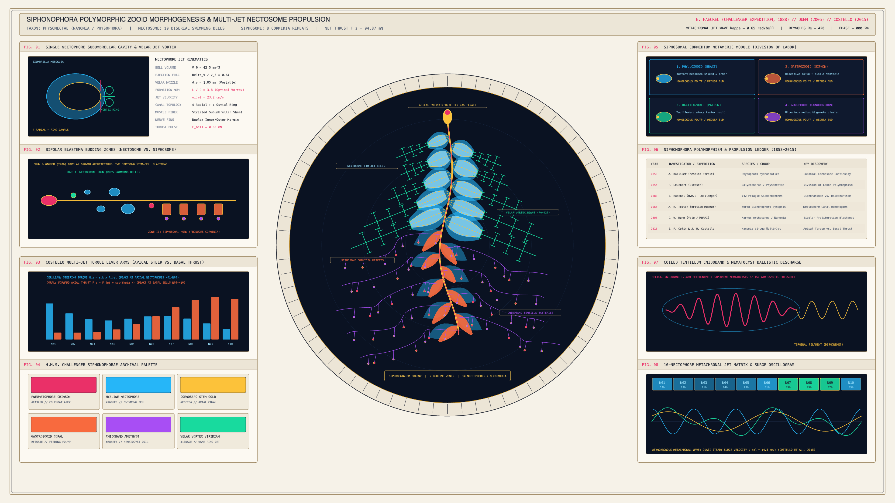

# kinetic_siphonophora_polymorphic_zooid_nectosome_propulsion_2d

> **"Siphonophora Polymorphic Zooid Morphogenesis & Multi-Jet Nectosome Propulsion"** — A 4K 60fps marine morphogenesis and multi-jet hydrodynamics animation of a colonial physonect siphonophore (*Nanomia bijuga* / *Physophora hydrostatica*) inspired by Ernst Haeckel's *H.M.S. Challenger* monograph (1888), Casey Dunn's bipolar blastema morphogenesis (2005), and Sean Colin & John Costello's multi-jet propulsion biomechanics (*PNAS*, 2015).



## Concept & Colonial Morphogenesis

A physonect siphonophore is not a single animal, but a genetically identical colonial superorganism of homologous polypoid and medusoid **zooids** budding continuously from two opposing stem-cell proliferation blastemas along a muscular axial **Coenosarc** stem:

1. **Apical Pneumatophore & Bipolar Budding Zones (`FIG. 02`)**: At the colony apex, a carbon-monoxide ($\text{CO}$) filled hydrostatic float (**Pneumatophore**) stabilizes vertical posture. Immediately below it, two opposing proliferation horns bud propulsive swimming bells (**Nectophores**) into the upper **Nectosome** and reiterative feeding/reproductive modules (**Cormidia**) into the lower **Siphosome**.
2. **Asynchronous Multi-Jet Nectosome Propulsion (`FIG. 01` & `FIG. 03`)**: Ten biserial hyaline swimming bells contract their striated subumbrellar cavities and narrow their muscular **Velum** nozzles in a traveling metachronal wave ($\psi_k(t) = 2\phi - 0.68 k$), shedding viridian vortex-ring chains ($L/D \approx 3.8$). As demonstrated by **Colin, Costello et al. (*PNAS*, 2015)**, small apical nectophores (`N01–N03`) act across a long lever arm to generate rapid steering torque ($M_z = \vec{r}_k \times \vec{F}_{\text{jet},k}$), whereas large basal nectophores (`N08–N10`) discharge nearly parallel to the stem to provide forward axial thrust ($F_z$).
3. **Siphosomal Cormidia & Coiled Cnidoband *Tentilla* (`FIG. 05` & `FIG. 07`)**: Along the lower stem, 9 repeating **Cormidia** modules deploy buoyant protective leaf-bracts (**Phyllozooids**), coral-vermilion feeding polyps (**Gastrozooids**), and sweeping pelagic fishing tentacle curtains armed with 63 hanging *tentilla* carrying helical **Cnidoband** nematocyst batteries.

## Technical Implementation

- **Vectorized Zooid & Vortex-Wake Geometry (`NumPy` + `py5`)**: All 10 multi-slice contracting nectophores, 40 propagating vortex-ring wake cross-bars, 9 hyaline phyllozooid bracts, 9 coral gastrozooids, and 72 catenary *tentilla* filaments are batched into `py5.QUADS` / `py5.vertices` and `py5.lines` arrays with zero particle streams.
- **Eight Biological & Hydrodynamic Telemetry Apparatuses (`FIG. 01`–`FIG. 08`)**: Includes the contracting nectophore & shed vortex ring cross-section, Dunn & Wagner bipolar blastema diagram, Costello apical-torque vs. basal-thrust bar chart, *H.M.S. Challenger* palette, 4-zooid cormidium division-of-labor chart, 1853–2015 historical ledger, helical cnidoband diagram, and 10-bell metachronal surge oscillogram.

## Run

```bash
uv run python sketch/kinetic_siphonophora_polymorphic_zooid_nectosome_propulsion_2d/main.py
```

