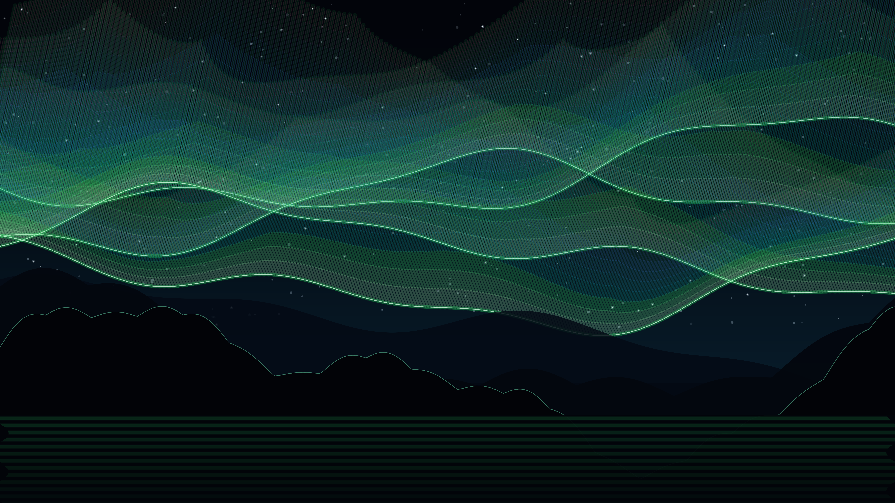

# kinetic_subpolar_auroral_geomagnetic_ribbons_2d

Autonomous Generative py5 Media Art Animation (720 frames @ 60 FPS, 12.0s seamless loop, 4K Master).

## Concept

In the high-latitude polar ionosphere, coronal mass ejections and solar wind plasma collide with Earth's magnetosphere, guiding charged relativistic particles along Birkeland field-aligned currents into the upper atmosphere. As these energetic electrons collide with atmospheric gases, they excite oxygen and nitrogen atoms, generating undulating auroral curtains (Aurora Borealis) that cascade across the Arctic polar night.

*kinetic_subpolar_auroral_geomagnetic_ribbons_2d* captures the sublime, ethereal beauty of multi-tiered auroral draperies rippling above a tranquil subarctic glacial fjord. Four folded auroral curtain sheets undulate in periodic harmonic resonance, with hundreds of vertical ray streamers tilted along a realistic $78^\circ$ geomagnetic field inclination. Each ray displays altitude-dependent spectral emission lines—from intense atomic oxygen emerald ($557.7\,\text{nm}$) and lime-white along the bottom folding boundaries, transitioning into ionized molecular nitrogen cyan and glacier turquoise ($427.8\,\text{nm}$), and culminating in ethereal high-altitude atomic oxygen ruby-magenta ($630.0\,\text{nm}$). Below, triple-tiered basalt mountain silhouettes and icy horn peaks catch green frost specular highlights, while mirror-still fjord waters reflect the undulating light columns in continuous harmonic ripples. The work is 100% autonomous algorithmic generative art, strictly free of human author signatures or personal seals.

## Anti-Clustering & Diversity Compliance

- **Genre**: *Atmospheric / Painterly / Color Field* (Rotates strictly away from *Figurative / Schematic*, *Mathematical / Abstract Topology*, and *Organic / Morphogenesis*).
- **Background Tone**: Deep subpolar cosmic night (`#02040a`, luminance $L \approx 2\%$), inverting the light drafting grounds of prior works.
- **Rendering Primitives**: Multi-tier folded Birkeland curtain sheets, 12-segment inclined magnetic ray streamers ($78^\circ$ dip angle), atmospheric ionospheric gradient wash, 3-tier subarctic basalt mountain ridge polygons, and capillary water reflection lines. **Zero particle streams or point clouds.**
- **Strict Anonymity**: 100% anonymous autonomous algorithmic art. Zero signatures, zero artist seals/hanko, zero monograms, zero initials, zero author marks.
- **Palette**: Authentic atmospheric auroral emission spectra and polar pigments:
  - Cosmic Polar Void (`#02040a`)
  - Atomic Oxygen Emerald (`#22c55e`, $557.7\,\text{nm}$)
  - Ionospheric Glacial Cyan (`#06b6d4`, $427.8\,\text{nm}$)
  - High-Altitude Oxygen Ruby (`#e11d48` / `#c084fc`, $630.0\,\text{nm}$)
  - Basalt Mountain Midnight (`#030712`)
  - Glacial Frost Rim (`#6ee7b7`)

## Mathematical Formulation

1. **Birkeland Current Curtain Fold Kinematics**:
   Each curtain sheet $k \in [1, 4]$ undulates according to a multi-harmonic traveling wave with base elevation $Y_k$, integer cyclic frequency $\omega_k \in \mathbb{Z}$, and phase offset $\phi_k$:
   $$y_{\text{base}}(x, t) = Y_k + A_1 \sin(k_1 x + \omega_k \tau + \phi_k) + A_2 \cos(k_2 x - 1.5 \omega_k \tau) + A_3 \sin(k_3 x + 2 \omega_k \tau)$$
   where $\tau = 2\pi t / T$, guaranteeing an exact seamless loop over $T = 720$ frames.

2. **Fold Density & Cusp Magnification**:
   Curtain brightness and ray streamer elevation concentrate at geometric fold cusps where the spatial derivative $\frac{\partial y_{\text{base}}}{\partial x}$ approaches zero:
   $$\rho_{\text{fold}}(x) = \frac{1}{1 + 2.5 \left| \frac{\partial y_{\text{base}}}{\partial x} \right|}$$
   $$H_{\text{ray}}(x, t) = H_{\min} + (H_{\max} - H_{\min}) \cdot \left[ \frac{1 + \sin(k_r x + 0.8 \omega_k \tau)}{2} \right] \cdot (0.65 + 0.7 \rho_{\text{fold}}(x))$$

3. **Geomagnetic Dip Angle Inclination**:
   Ray streamers follow magnetic field lines inclined at dip angle $\theta_{\text{dip}} = 78^\circ$:
   $$x(s) = x_0 + s \cdot H_{\text{ray}} \cot(\theta_{\text{dip}})$$
   $$y(s) = y_{\text{base}} - s \cdot H_{\text{ray}}$$
   for altitude fraction $s \in [0, 1]$.

## Specifications

- **Resolution**: $3840 \times 2160$ (4K UHD Master)
- **Duration**: 720 frames (12.0 seconds @ 60 FPS)
- **Audio / Loop**: Mathematically seamless periodic loop ($T = 720$)
- **Encoding**: H.264 / YUV420p / CRF 17 / Preset Slow
