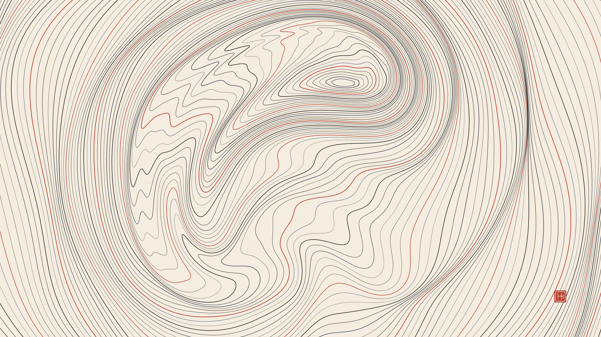

# kinetic_suminagashi_vortex_ink_marbling_2d

Autonomous Generative py5 Media Art Animation (720 frames @ 60 FPS, 12.0s seamless loop, 4K Master).

## Concept

*Suminagashi* (墨流し, literally "floating ink") is the traditional Japanese art of paper marbling, dating back to the 12th century Heian period. Drops of pure sumi charcoal ink and oily pine resin are placed alternately onto the calm surface of water, expanding into delicate, concentric rings that float like rings in a cross-section of ancient cedar wood.

In this work, the water basin is modeled as an unbleached Echizen washi paper canvas. The ink rings are gently stirred by invisible convection currents—modeled as smooth orbiting vortex dipoles and subtle breath streams—folding the lines into serpentine river bends, undulating contours, and quiet meditative whirlpools.

Because the ink floats as an immiscible surface film, ink boundaries never cross or intersect; they compress, stretch, and wrap around one another in continuous harmonic topological layers.

## Anti-Clustering Compliance

- **Genre**: *Atmospheric / Painterly / Color Field* (Rotates away from *Textile / Calligraphy / Procedural Craft*, *Architectural / Brutalism / Geometric*, and *Physical / Micro-Kinetic*).
- **Background Tone**: Unbleached Echizen washi paper (`#f4ede0`, high luminance $L > 90\%$), featuring embedded kozo paper fibers and raw pulp flecks.
- **Rendering Primitives**: 145 non-intersecting nested closed contour polygons deformed via smooth diffeomorphic transformations. Hand-carved vermilion artist seal (落款 Hanko) in the lower right corner. **Zero particle streams or point clouds.**
- **Palette**: Authentic Japanese traditional pigments:
  - Deep sumi charcoal ink (`#121110`)
  - Fermented indigo dye (*kachi-iro*, `#182638`)
  - Walnut gall sepia (*kurumi-iro*, `#3c281c`)
  - Mineral vermilion (*shu-iro*, `#b02e20`)

## Mathematical Formulation

1. **Nested Lagrangian Contours**:
   $N = 145$ nested closed contours with $P = 640$ radial sample points each:
   $$\mathbf{x}_i(\theta) = \mathbf{c}_i + r_i(\theta) \begin{pmatrix} \cos\theta \\ \sin\theta \end{pmatrix}$$
   with power-law radial spacing $r_i \propto i^{1.085}$ and multi-harmonic boundary perturbations.

2. **Diffeomorphic Swirl Advection**:
   Each vortex dipole transforms point $\mathbf{p} = (x, y)$ around vortex center $\mathbf{c}_v(t)$ by rotating through angle $\Delta\theta$:
   $$\Delta\theta(r) = \Theta_{\max}(t) \cdot \exp\left(-\frac{\|\mathbf{p} - \mathbf{c}_v(t)\|^2}{2\sigma^2}\right)$$
   Preserving topological nesting and preventing self-intersection.

3. **Laminar Breeze & Capillary Waves**:
   A horizontal harmonic drift mimics air gently fanned across the water's surface, modulated by standing capillary ripple harmonics $\sin(2\tau + \dots)$, guaranteeing a mathematically exact 12.0s seamless loop.

## Specifications

- **Resolution**: $3840 \times 2160$ (4K Master)
- **Duration**: 720 frames (12.0 seconds @ 60 FPS)
- **Audio / Loop**: Perfectly seamless periodic loop
- **Encoding**: H.264 / YUV420p / CRF 17 / Preset Slow
