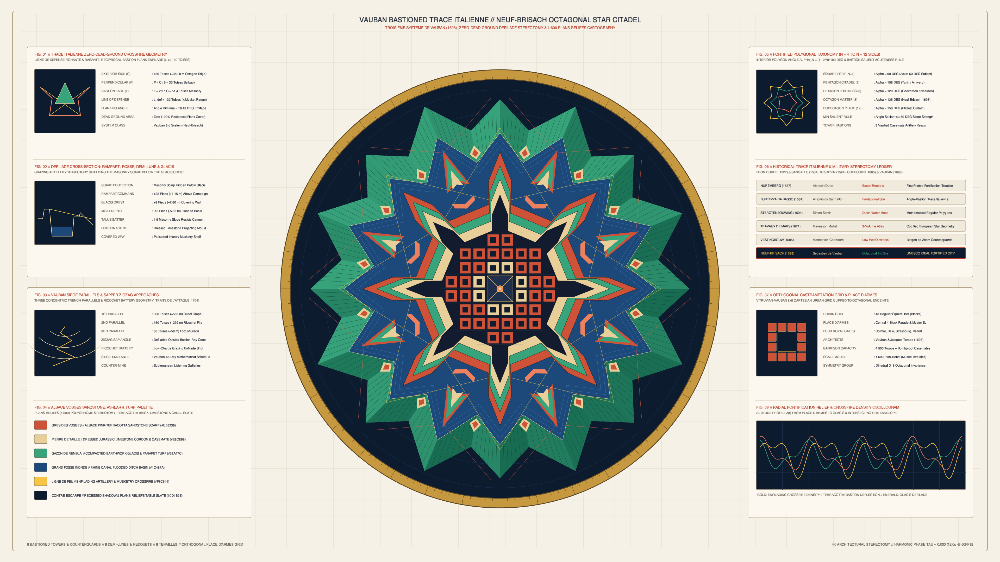

# kinetic_vauban_bastioned_trace_italienne_polygonal_citadel_2d

## Overview

- **Date**: 2026-11-05
- **Genre**: Architectural / Brutalism / Geometric
- **Format**: 4K 60fps Seamless Loop Animation (3840×2160, 720 frames / 12.0s)
- **Background**: Light — Warm *Génie Militaire* Cartographic & Stereotomy Vellum (`#f5f1e6`)

## Concept & Ballistic Stereotomy

Inspired by **Sébastien Le Prestre de Vauban's** *Troisième Système* masterwork at **Neuf-Brisach** (1698–1706, designed with Jacques Tarade), **Menno van Coehoorn's** *Nieuwe Vestingbouw* (1685), **Allain Manesson Mallet's** *Les Travaux de Mars* (1671), **Simon Stevin's** *Sterctenbouwing* (1594), and the 1:600 scale **Plans-Reliefs** collection:

1. **Zero-Dead-Ground Crossfire & *Trace Italienne* Proportions**:
   - Constructed on a regular octagon ($N = 8$, interior angle $\alpha_8 = 135^\circ$) with exterior side $C = 180\text{ Toises}$ ($\sim 350.8\text{ m}$), perpendicular setback $P = C/6 = 30\text{ Toises}$, and bastion face $F = \frac{2}{7}C = 51.4\text{ Toises}$.
   - Every curtain and ditch face is swept by reciprocal **Lines of Defense (*Lignes de Défense Fichante & Rasante*)** of length $L_{\text{def}} = 132\text{ Toises}$, eliminating all ballistic dead zones at the base of the scarp.

2. **Concentric Outwork Hierarchy & Orthogonal Castrametation**:
   - From outside in: (1) Sloping hachured turf **Glacis** and **Covered Way (*Chemin Couvert*)** with 16 diamond **Re-entrant Places of Arms**; (2) Flooded **Grand Fossé** moat; (3) Eight triangular **Demi-Lunes (Ravelins)** with nested stone **Redoubts (*Réduits*)** and curtain **Tenailles**; (4) Eight pentagonal **Bastions / Counterguards** in Vosges pink-terracotta sandstone with vaulted **Bastioned Towers (*Tours Bastionnées*)** at their gorges; and (5) an orthogonal $8 \times 8$ **Castrametation Grid** of 44 courtyard garrison blocks framing the central 4-block **Place d'Armes**.

