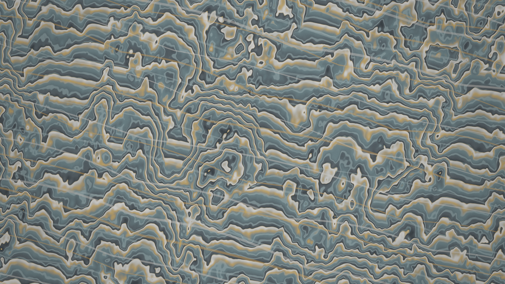

# lichen_travertine_terraces

## Metadata
- **Date**: 2026-11-14
- **Genre**: Organic / Morphogenesis
- **Composition Archetype**: Stratified Horizon / Diagonal Sweep
- **Motion Archetype**: Directional Advection & Traveling Wavefronts
- **Tonal Family**: Mid-Tone Atmospheric Dusk / Celadon Slate
- **Theme**: Thermal mineral waters cascading across diagonally stratified travertine rimstone dams and thermophilic amber-lichen accretion bands at dusk
- **Technique**: Diagonal scalloped step-function morphogenesis & micro-fluted calcite rib shader (`lichen_travertine_terraces.glsl`) + 32 scalloped rimstone contour ribbons (`py5.QUADS`) + `PostFX`
- **Logic Lab Reference**: None

## Concept
Sweeping diagonally across the entire 3840×2160 canvas, 15 stepped travertine rimstone terraces (*gours*) partition a mid-tone celadon-slate dusk field (`#363c40`–`#4a5d62`). Along the overhanging lip of each scalloped mineral dam, calcified chalk micro-ribs (`#e4dfd4`) and thermophilic amber-ochre lichen colonies (`#d88c32`) accrete while gentle caustic ripples cascade from pool to pool.

## Technical Details
- **Renderer**: `P2D` (OpenGL)
- **Simulation**: Multi-octave fBm + scalloped cusp step quantization and micro-crenulation modulation in GLSL + 32×84 vectorized rimstone ribbon contours in NumPy
- **Visuals**: Full-bleed diagonal strata (`load_shader` + `draw_fullscreen`), translucent mineral/lichen contour ribbons (`py5.QUADS`), and `PostFX` (`bloom=0.28`, `tonemap=0.94`, `vignette=0.14`, `grain=0.022`)
- **Animation**: 20s (1200 frames @ 60fps)

