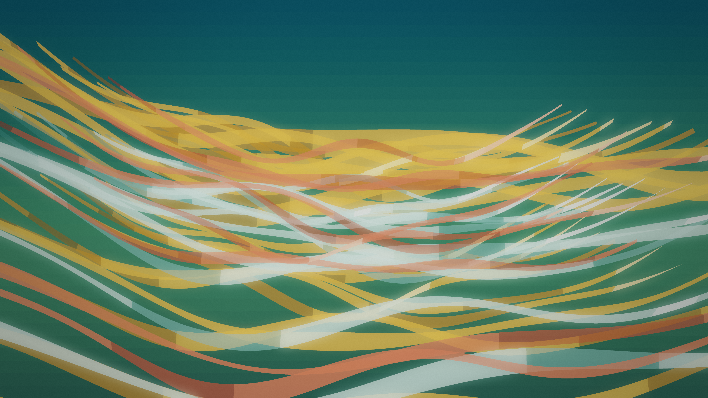

# viridian_catenary_canopy

## Metadata
- **Date**: 2026-11-14
- **Genre**: Textile / Calligraphy / Procedural Craft
- **Composition Archetype**: 3D Sculptural / Volumetric Space (P3D)
- **Motion Archetype**: Poly-Rhythmic Phase Interference
- **Tonal Family**: Rich Saturated Color Field
- **Theme**: Billowing 3D canopies of translucent saffron, persimmon, and celadon organza suspended in a deep forest-viridian atrium and rippling with golden-ratio poly-rhythmic wave interference
- **Technique**: True `P3D` volumetric catenary surface synthesis ($\cosh(ku)$ vaults + golden-ratio harmonic wave superposition) with analytical two-sided 3D normal illumination and `PostFX` bloom
- **Logic Lab Reference**: None

## Concept
Suspended in a deep forest-viridian 3D space (`#103634`), 36 articulated catenary silk-organza sheets drape across a wide volumetric atrium. Incommensurable harmonic wave trains ($\omega_2 = \varphi \omega_1$, $\omega_3 = \varphi^{-1} \omega_1$) travel along both longitudinal warp and transverse weft axes while the 3D camera glides smoothly around the billowing saffron-amber (`#f29e2e`), pale celadon (`#d8ece2`), and warm persimmon (`#e85a3c`) folds.

## Technical Details
- **Renderer**: `P3D` (3D OpenGL)
- **Simulation**: Vectorized 36×64 catenary surface mesh with golden-ratio poly-rhythmic wave interference and analytical surface normal cross-products in NumPy
- **Visuals**: Two-sided translucent organza Lambertian + rim illumination batched across 12 3D `py5.QUADS` bins + `PostFX` (`bloom=0.36`, `tonemap=0.95`, `vignette=0.16`, `grain=0.022`)
- **Animation**: 19s (1140 frames @ 60fps)

